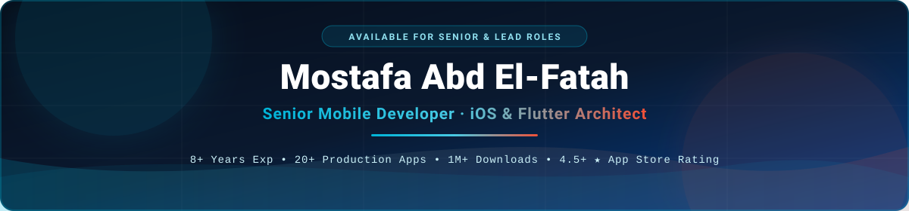
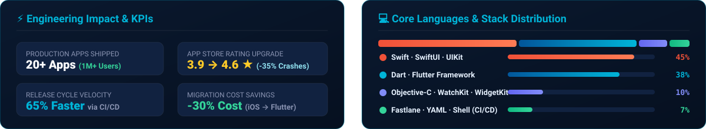

<div align="center">

<!-- Self-Hosted Hero Banner (Instant Load, Works Offline & on GitHub) -->


<br/><br/>

<!-- Social & Contact Badges -->
<p align="center">
  <a href="https://www.linkedin.com/in/mostafa-abd-el-fatah-a89195131">
    
  </a>
  <a href="mailto:m.abdelfatah.fci@gmail.com">
    
  </a>
  <a href="https://github.com/MostafaAbdElFatah">
    
  </a>
</p>

<!-- Quick Metric Pills -->
<p align="center">
  
  
  
  
</p>

</div>

---

## ⚡ Executive Summary

Senior Mobile Developer with **8+ years of experience** building and scaling high-performance mobile apps across **finance, e-commerce, and multimedia**.

```yaml
name: Mostafa Abd El-Fatah
role: Senior Mobile Developer · iOS & Flutter Specialist
experience: 8+ Years (20+ Production Apps · 1M+ Downloads · 4.5+ ★ Rating)
domains:
  - FinTech & Secure Payment Integrations
  - High-Scale E-Commerce Platforms
  - Multimedia & Offline-First Consumer Apps
core_focus:
  - Designing modular, clean, and testable mobile architectures
  - Leading zero-downtime Native iOS to Flutter migrations
  - Automating end-to-end release pipelines (GitHub Actions, Fastlane, Azure DevOps)
  - Mentoring engineering teams & driving high-velocity Agile delivery
```

---

## 📊 Engineering Stats & Top Languages

<div align="center">
  
</div>

---

## 🌐 What I Do Best

<table>
  <tr>
    <td width="33%" valign="top">
      <h3>✅ End-to-End Delivery</h3>
      <p>Architect, build, and ship polished mobile experiences across <b>iOS</b> and <b>Flutter</b>—from concept to App Store & Google Play release.</p>
    </td>
    <td width="33%" valign="top">
      <h3>🏗️ Scalable Architecture</h3>
      <p>Design modular, secure, and maintainable codebases utilizing <b>Clean Architecture, MVVM, VIPER</b>, and strict Dependency Injection.</p>
    </td>
    <td width="33%" valign="top">
      <h3>🔁 Strategic Migrations</h3>
      <p>Lead seamless transitions from legacy <b>Native iOS to Flutter</b>, cutting development overhead while maintaining native-grade performance.</p>
    </td>
  </tr>
  <tr>
    <td width="33%" valign="top">
      <h3>⚡ Performance & Stability</h3>
      <p>Profile memory, eliminate bottlenecks, and optimize rendering to sustain <b>95%+ crash-free sessions</b> and smooth 60/120fps UX.</p>
    </td>
    <td width="33%" valign="top">
      <h3>🔄 CI/CD Automation</h3>
      <p>Build automated testing, code-signing, and deployment pipelines using <b>Fastlane, GitHub Actions, and Azure DevOps</b>.</p>
    </td>
    <td width="33%" valign="top">
      <h3>👥 Technical Leadership</h3>
      <p>Mentor junior/mid engineers, enforce code review standards, and collaborate closely with product & design stakeholders.</p>
    </td>
  </tr>
</table>

---

## 📈 Career Highlights

<div align="center">

| Impact | Key Achievement | Result |
| :--- | :--- | :---: |
| 🚀 **Stability** | Eliminated critical memory leaks & concurrency bugs, raising App Store rating | **`-35% Crashes`** · **`3.9 → 4.6 ⭐`** |
| 💰 **Cost** | Spearheaded a strategic **Native iOS → Flutter** cross-platform migration | **`-30% Dev Cost`** |
| ⚡ **Delivery** | Automated build, test, and store deployment workflows with **CI/CD** pipelines | **`-65% Release Cycles`** |
| 📊 **Engagement** | Redesigned core user journeys through UX & analytics-driven decisions | **`+20% Engagement`** |
| 👨‍🏫 **Mentorship** | Established unit testing culture, PR guidelines, and active junior mentorship | **`-20% Team Bug Rate`** |

</div>

---

## 📱 Featured Apps

<table>
  <tr>
    <td width="33%" valign="top">
      <h3>📖 Quran App — Flutter</h3>
      <p>
        
        
        
      </p>
      <ul>
        <li><b>Full offline support</b> for audio & text</li>
        <li>Reactive state management with <b>RxDart</b></li>
        <li>Smart push & local notifications</li>
      </ul>
    </td>
    <td width="33%" valign="top">
      <h3>🛒 E-Commerce App</h3>
      <p>
        
        
      </p>
      <ul>
        <li><b>Secure payment</b> gateway integration</li>
        <li><b>Firebase Analytics</b> for funnel insights</li>
        <li>Optimized checkout & deep linking</li>
      </ul>
    </td>
    <td width="33%" valign="top">
      <h3>🎥 Multimedia & Utilities</h3>
      <p>
        
        
      </p>
      <ul>
        <li><b>10+ production apps</b> shipped at scale</li>
        <li>Custom media processing, <b>WidgetKit</b> & <b>WatchKit</b></li>
        <li>Sustained <b>95%+ crash-free</b> sessions</li>
      </ul>
    </td>
  </tr>
</table>

---

## 🛠️ Tech Stack

<div align="center">

### 📱 Mobile Development


### ☁️ Backend & Data


### ⚙️ DevOps & Tools


</div>

---

## 🏗️ Architecture, Practices & How I Work


- **Patterns:** MVC, MVVM, VIPER, Clean Architecture, Modular Design, Dependency Injection
- **Quality:** Unit Testing, Test Automation, Crash & Performance Optimization
- **Security:** App Security & Encryption
- **Growth:** App Store Optimization (ASO), Analytics-driven UX
- **Mindset:** Business-driven engineering decisions · Clean, testable, maintainable code · Close cross-functional collaboration · Continuous improvement (`Agile / Scrum`)

---

<div align="center">
  
</div>
