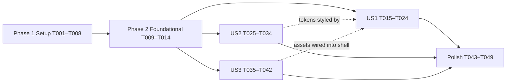

# Tasks: Phase 1 — Project Foundation, Modular Token System & Visual Assets

**Input**: Design documents from `/specs/001-foundation-and-tokens/`
**Prerequisites**: [plan.md](./plan.md), [spec.md](./spec.md), [research.md](./research.md), [data-model.md](./data-model.md), [contracts/](./contracts/), [quickstart.md](./quickstart.md)
**Constitution**: v1.1.0

**Tests**: Included — Constitution VII requires Vitest coverage and the plan defines three test suites (architecture boundaries, theme-token parity, contrast). Write them first and confirm they fail.

**Organization**: Grouped by user story from spec.md:
- **US1 (P1)** Modular project structure & build pipeline (FR-001, FR-002, FR-003, FR-005, FR-006)
- **US2 (P1)** Dual-theme luxury gold design token system (FR-002 tokens, SC-003)
- **US3 (P2)** Brand & visual asset availability (FR-004, SC-004)
- FR-007 (content integrity) is handled in Foundational + Polish.

## Format: `- [ ] T### [P?] [Story?] Description with file path`

---

## Phase 1: Setup (Shared Infrastructure)

**Purpose**: Toolchain and configuration (research R1, R2; contract `project-scripts-and-boundaries.md` §1)

- [ ] T001 Create `package.json` with `"type": "module"`, scripts `dev`, `build`, `preview`, `lint`, `lint:js`, `lint:css`, `format`, `format:check`, `test`, `test:watch`, `images`, and devDependencies `vite ^8.3.5`, `esbuild ^0.28.2`, `vite-plugin-html ^3.2.2`, `html-minifier-terser ^7.2.0`, `eslint`, `@eslint/js`, `globals`, `stylelint`, `stylelint-config-standard`, `prettier`, `vitest`, `jsdom`, `sharp`; dependencies `@fontsource/playfair-display`, `@fontsource-variable/inter`, `@fontsource/noto-naskh-arabic` in `package.json`
- [ ] T002 [P] Create `vite.config.js` using `vite-plugin-html` (minify, inject `title`/`description`/`siteUrl` data), `build.outDir: 'dist'`, `publicDir: 'public'`
- [ ] T003 [P] Create `eslint.config.js` (flat config: `@eslint/js` recommended, browser globals, `no-var`, `prefer-const`, `no-restricted-syntax` banning `innerHTML` assignment) with per-layer `no-restricted-imports` / `no-restricted-globals` overrides for `src/scripts/domain/**`, `src/scripts/data/**`, `src/scripts/presentation/**` per contract §2
- [ ] T004 [P] Create `stylelint.config.js` extending `stylelint-config-standard` with `color-no-hex`, disallowed `rgb()/hsl()` values, `declaration-no-important`, `selector-max-id: 0`, BEM `selector-class-pattern`, `selector-max-compound-selectors: 3`; override allowing raw colors in `src/styles/tokens/**` and `!important` in `src/styles/utilities/**`
- [ ] T005 [P] Create `.prettierrc.json` and `.prettierignore` (ignore `dist/`, `node_modules/`, `legacy/`, `src/assets/source/`, `package-lock.json`)
- [ ] T006 [P] Create `vitest.config.js` (environment `node` by default, `jsdom` for `tests/dom/**`, include `tests/**/*.test.js`)
- [ ] T007 [P] Update `.gitignore` with `node_modules/`, `dist/`, `.DS_Store`, `*.log`, `.env*`, `coverage/`
- [ ] T008 Run `npm install` (requires network approval) and commit `package-lock.json`; resolve any `vite-plugin-html` peer conflict per plan Risks

---

## Phase 2: Foundational (Blocking Prerequisites)

**Purpose**: Directory scaffold and safe migration of existing content (research R4, R10). Blocks all user stories.

- [ ] T009 Create directories `src/scripts/{domain,data,presentation}`, `src/styles/{tokens,base,utilities,layout,components,pages/home,vendor/fontawesome}`, `src/assets/{source,icons,images/brand,images/hero,images/projects,images/profile}`, `public/docs`, `scripts/`, `legacy/`, `tests/{architecture,tokens}`
- [ ] T010 [P] Write layer contracts `src/scripts/domain/README.md`, `src/scripts/data/README.md`, `src/scripts/presentation/README.md` (responsibility, allowed imports, forbidden globals) per constitution I/II
- [ ] T011 [P] Move `assets/Mostafa-Abdel-Fattah-CV.pdf` to `public/docs/Mostafa-Abdel-Fattah-CV.pdf`
- [ ] T012 [P] Move `js/data.js` to `legacy/data.js` unchanged (input for Phase 2 mapping)
- [ ] T013 [P] Copy original uploads (logo PNG, design board JPG, suit photo PNG) into `src/assets/source/` as `logo-ma-original.png`, `design-board.jpg`, `profile-suit-original.png`
- [ ] T014 Add `src/styles/vendor/fontawesome/README.md` noting the folder is reserved and not imported (plan Complexity Tracking)

**Checkpoint**: Structure exists, legacy content safe — user stories may start (US1, US2, US3 can proceed in parallel).

---

## Phase 3: User Story 1 — Modular Project Structure & Build Pipeline (Priority: P1) 🎯 MVP

**Goal**: A semantic, SEO-ready shell built by Vite from `src/styles/main.css` + `src/scripts/main.js`, with lint/format/test gates and enforced architecture boundaries.

**Independent Test**: `npm run lint && npm run format:check && npm test && npm run build` all exit 0; `dist/index.html` renders existing content with a skip link and landmarks; no external network requests.

### Tests for User Story 1 ⚠️ (write first, confirm failing)

- [ ] T015 [P] [US1] Write `tests/architecture/boundaries.test.js` using the ESLint Node API to lint fixture snippets: domain importing `../data/x.js` → error; domain using `document` → error; presentation importing `../data/x.js` → error; `main.js` importing all layers → no error
- [ ] T016 [P] [US1] Write `tests/dom/shell.test.js` (jsdom) parsing `index.html`: exactly one `<h1>`, `<main id="main">`, skip link targeting `#main`, `<meta name="description">`, `og:image`, JSON-LD `Person`, `color-scheme` meta, no `cdn.` script sources

### Implementation for User Story 1

- [ ] T017 [P] [US1] Create `src/styles/base/normalize.css` (modern reset: box-sizing, margin reset, media defaults, `text-size-adjust`)
- [ ] T018 [P] [US1] Create `src/styles/base/globals.css` (body surface/text from semantic tokens, `--font-sans`, headings in `--font-display`, links in `--color-accent`, `:focus-visible` ring with `--color-focus-ring`, `:lang(ar)` → `--font-arabic` + `unicode-bidi: isolate`, `scroll-behavior` gated by reduced motion, logical properties only)
- [ ] T019 [P] [US1] Create `src/styles/utilities/visually-hidden.css` (`.visually-hidden`, `.visually-hidden-focusable`)
- [ ] T020 [P] [US1] Create `src/styles/layout/container.css` (`.container` with `max-inline-size: var(--container-max)`, `padding-inline: var(--container-pad)`, `margin-inline: auto`)
- [ ] T021 [US1] Create `src/styles/main.css` with the Phase 1 cascade from `contracts/css-tokens-and-assets.md` §3 (fonts → tokens → base → utilities → layout; placeholder comments for components/pages)
- [ ] T022 [US1] Create `src/scripts/main.js` composition root (imports `../styles/main.css`; documented empty wiring section for Phase 2)
- [ ] T023 [US1] Rewrite `index.html` as the shell per contract §3: head meta/SEO/OG/Twitter/JSON-LD, favicons, inline theme bootstrap, `type="module"` entry; body with skip link, `<header>`, `<main id="main">`, `<footer>`; keep all current hero/projects/skills/contact text as static fallback using semantic markup and BEM classes; remove Alpine CDN and `x-*` attributes; Arabic names wrapped in `<span lang="ar" dir="rtl">`
- [ ] T024 [US1] Run `npm run lint`, `npm run format:check`, `npm test` (T015, T016 now pass) and `npm run build`; fix all findings

**Checkpoint**: US1 independently verifiable — site builds and passes all gates with legacy content.

---

## Phase 4: User Story 2 — Dual-Theme Luxury Gold Design Token System (Priority: P1)

**Goal**: Three-tier token system (data-model §1) with identical semantic names in dark/light and AA contrast.

**Independent Test**: `npm test` token suites pass; toggling `data-theme` in DevTools switches all surfaces/ink/accents with no layout shift; reduced-motion zeroes durations.

### Tests for User Story 2 ⚠️ (write first, confirm failing)

- [ ] T025 [P] [US2] Write `tests/tokens/theme-parity.test.js`: parse `semantic-dark.css` and `semantic-light.css`, assert identical custom-property name sets and that both include every name in contract §2
- [ ] T026 [P] [US2] Write `tests/tokens/contrast.test.js`: resolve primitives → semantic values and assert WCAG ratios (`--color-text` ≥ 15:1, `--color-text-muted` ≥ 4.5:1, `--color-accent` ≥ 4.5:1, `--color-on-accent` on `--color-accent-fill` ≥ 7:1, `--color-focus-ring` ≥ 3:1) for both themes

### Implementation for User Story 2

- [ ] T027 [P] [US2] Create `src/styles/tokens/primitives.css` (obsidian, ivory, gold scales, `--gradient-gold`, gold alpha tokens — data-model §1.2)
- [ ] T028 [P] [US2] Create `src/styles/tokens/semantic-dark.css` on `:root, [data-theme="dark"]` (data-model §1.3 dark column, `color-scheme: dark`)
- [ ] T029 [P] [US2] Create `src/styles/tokens/semantic-light.css` on `[data-theme="light"]` (data-model §1.3 light column, `color-scheme: light`; accent text = gold-700)
- [ ] T030 [P] [US2] Create `src/styles/tokens/typography.css` (font-family stacks, fluid `--text-*` scale, `--text-hero`, line-heights, `--tracking-wide`)
- [ ] T031 [P] [US2] Create `src/styles/tokens/spacing.css` (`--space-*`, container tokens, radii, breakpoint reference comments)
- [ ] T032 [P] [US2] Create `src/styles/tokens/motion.css` (easings, durations, `prefers-reduced-motion` override)
- [ ] T033 [US2] Create `src/styles/tokens/components.css` (header, button, chip, icon-badge, card, `--tap-target-min` tokens built from semantic/scale tokens — depends on T027–T032)
- [ ] T034 [US2] Run `npm test` (T025, T026 pass) and `npm run lint:css`; verify quickstart §4 scenarios 1–4 in `npm run dev`

**Checkpoint**: US2 independently verifiable — themes switch correctly and meet contrast.

---

## Phase 5: User Story 3 — Brand & Visual Asset Availability (Priority: P2)

**Goal**: All assets from data-model §2 present locally, optimized, documented.

**Independent Test**: `ls` of asset folders shows every file; size targets met; zero external requests in the Network tab; images referenced by the shell load with HTTP 200.

### Implementation for User Story 3

- [ ] T035 [US3] Create `scripts/optimize-images.mjs` (sharp): trim + near-white→alpha for logo, derive white variant from alpha mask, crop monogram mark, emit WebP/PNG (+AVIF for portrait) at configured widths, generate favicons 32/180/512, compose 1200×630 OG image; idempotent, reads from `src/assets/source/`
- [ ] T036 [P] [US3] Author `src/assets/icons/sprite.svg` with `<symbol>` IDs `sun moon download arrow-right menu close check code layers globe user grid settings github linkedin mail phone app-store google-play` (stroke `currentColor`, 24×24 viewBox) and copy to `public/icons.svg`
- [ ] T037 [P] [US3] Author `src/assets/images/hero/hero-orbit.svg` (thin elliptical gold arcs + star dots using `currentColor`, ≤ 5 KB, `aria-hidden` usage)
- [ ] T038 [P] [US3] Generate hi-res Hero side-profile portrait (≥ 1200×1500, dark-fade background) from the design board reference into `src/assets/source/hero-portrait.png`; fallback: crop + lanczos upscale, flagged in asset README
- [ ] T039 [P] [US3] Generate 4 project visuals (Health & Wellness, Travel & Lifestyle, Architecture, Project Card — phone mockups on obsidian) into `src/assets/source/project-{health,travel,architecture,card}.png`; same fallback as T038
- [ ] T040 [US3] Run `npm run images` to produce `src/assets/images/brand/logo-ma-{gold,white,mark}.{webp,png}`, `src/assets/images/hero/hero-portrait-{480,800,1200}.{avif,webp,png}`, `src/assets/images/projects/project-*.{webp,png}`, `src/assets/images/profile/profile-suit.{webp,png}`, `public/favicon-32.png`, `public/apple-touch-icon.png`, `public/icon-512.png`, `public/og-image.jpg` (depends on T035, T038, T039)
- [ ] T041 [US3] Write `src/assets/README.md` manifest: every asset's path, intrinsic width/height, byte size vs. target, alt text (or "decorative"), source (uploaded / generated / derived)
- [ ] T042 [US3] Wire brand mark, favicons and OG image into `index.html` `<head>`/header with `width`/`height`, `alt`, and `<picture>` WebP + PNG fallback; verify all requests are same-origin

**Checkpoint**: US3 independently verifiable — all assets local, optimized and documented.

---

## Phase 6: Polish & Cross-Cutting Concerns

- [ ] T043 Delete legacy `css/`, `js/` and empty `assets/` directories after confirming `legacy/data.js` holds all 33 projects and `public/docs/` holds the CV (FR-007)
- [ ] T044 [P] Write `README.md`: architecture overview (layers + import rules), styles cascade, npm scripts, Spec Kit phase workflow and status
- [ ] T045 Run `npm run lint` and `npm run format:check` with zero errors
- [ ] T046 Run `npm test` — all suites (boundaries, shell, parity, contrast) green
- [ ] T047 Accessibility check (WCAG 2.2 AA): keyboard-only pass, skip link, focus ring, contrast both themes, `lang`/`dir` on Arabic text, alt text
- [ ] T048 Run `npm run build` then `npx vite preview`; Lighthouse mobile: Accessibility ≥ 95, Best Practices ≥ 95, SEO ≥ 95; confirm Phase 1 CSS ≤ 15 KB gzip and JS ≤ 2 KB gzip
- [ ] T049 Execute every scenario in `specs/001-foundation-and-tokens/quickstart.md` and record results in `specs/001-foundation-and-tokens/checklists/validation.md`

---

## Dependencies & Execution Order



- **Setup → Foundational** are strictly sequential; T008 (`npm install`) blocks all lint/test/build tasks.
- **US1, US2, US3** can start in parallel after Foundational. US1's gate run (T024) passes with tokens absent, but visual verification of the shell is best done after T033. T042 edits `index.html`, so run it after T023.
- **Within each story**: tests → implementation → gate run.
- **Polish** requires all three stories.

## Parallel Execution Examples

**Setup**: T002, T003, T004, T005, T006, T007 together (separate config files).

**US1**:
```text
T015 boundaries.test.js   |  T016 shell.test.js
T017 normalize.css | T018 globals.css | T019 visually-hidden.css | T020 container.css
```

**US2**:
```text
T025 theme-parity.test.js | T026 contrast.test.js
T027 primitives | T028 semantic-dark | T029 semantic-light | T030 typography | T031 spacing | T032 motion
```

**US3**:
```text
T036 sprite.svg | T037 hero-orbit.svg | T038 portrait generation | T039 project visuals
```

## Implementation Strategy

- **MVP**: Setup + Foundational + US1 → a lint-clean, tested, building Vite site with all legacy content preserved.
- **Increment 2**: US2 → the shell adopts the gold dark/light token system.
- **Increment 3**: US3 → brand assets, favicons, OG image; Phase 1 closes after Polish gates.
- Commit after each task group; stop at each checkpoint to verify independently.

## Summary

| Group | Tasks | Count |
|---|---|---|
| Setup | T001–T008 | 8 |
| Foundational | T009–T014 | 6 |
| US1 | T015–T024 | 10 |
| US2 | T025–T034 | 10 |
| US3 | T035–T042 | 8 |
| Polish | T043–T049 | 7 |
| **Total** | | **49** |
