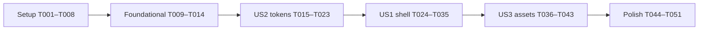

# Tasks: Phase 1 — Project Foundation, Modular Token System & Visual Assets

**Feature dir**: `specs/001-foundation-and-tokens/` · **Constitution**: v1.1.0
**Inputs**: [spec.md](./spec.md) · [plan.md](./plan.md) · [research.md](./research.md) · [data-model.md](./data-model.md) · [contracts/](./contracts/) · [quickstart.md](./quickstart.md)
**Total tasks**: 51 · **Stories**: US2 → US1 → US3 (US2 runs first because the shell needs the tokens)

---

## 0. Rules for the implementing agent (read before T001)

1. **Work strictly in order**, one task at a time. Do not start a task until the previous task's **Done when** checks pass.
2. **Exact content**: when a task gives a code block, write it exactly (you may only fix obvious typos). When a task says "adjust", look at the result and change only the listed values.
3. **Only touch the files listed in the task** (plus ticking the checkbox in this file).
4. **Formatting**: from T004 onward, after creating/editing files run `npx prettier --write <the files you changed>` (skip binary files, `legacy/`, `public/`, `src/assets/`).
5. **After every task**:
   1. Run the **Done when** checks.
   2. Change the task's `- [ ]` to `- [X]` in this file.
   3. Commit only that task's files + this file: `git add <files> specs/001-foundation-and-tokens/tasks.md && git commit -m "<suggested message>"`.
   4. Print the summary line: `✅ T0xx done — commit: <message>`.
6. **Commit messages** follow Conventional Commits — `<type>(<scope>): <description>`:
   - types: `feat` (new capability), `fix` (bug), `refactor` (restructure, no behavior change), `style` (visual/CSS styling), `chore` (tooling/config), `test`, `docs`, `build`, `perf`.
   - imperative, lower case, no trailing period, ≤ 72 chars. Breaking change: `feat(scope)!: …` plus `BREAKING CHANGE: …` in the body.
   - Examples: `refactor(css): centralize design tokens and improve comments`, `style(contact): refine contact section layout`, `feat(features): add responsive feature cards`, `fix(pricing): correct price alignment`.
   - Every task below ends with a **Suggested commit**. Use it unless you changed scope.
7. **Stop and report** (do not improvise) if: a check fails twice after fixing, a command needs network other than T002, a file you must read does not exist, or a task says **STOP**.
8. Never use `innerHTML`, never add CDN links, never put hex/rgb colors outside `src/styles/tokens/`.

---

## Phase 1: Setup (shared tooling)

- [X] T001 Create `package.json`
  - **Write** `package.json`:
    ```json
    {
      "name": "mostafa-portfolio",
      "version": "2.0.0",
      "private": true,
      "type": "module",
      "scripts": {
        "dev": "vite",
        "build": "vite build",
        "preview": "vite preview",
        "lint": "npm run lint:js && npm run lint:css",
        "lint:js": "eslint .",
        "lint:css": "stylelint \"src/styles/**/*.css\"",
        "format": "prettier --write .",
        "format:check": "prettier --check .",
        "test": "vitest run",
        "test:watch": "vitest",
        "icons": "node scripts/build-icons.mjs",
        "images": "node scripts/optimize-images.mjs",
        "images:fallback": "node scripts/crop-board-fallback.mjs",
        "render:fallback": "node scripts/render-static-projects.mjs && prettier --write index.html"
      },
      "devDependencies": {
        "esbuild": "^0.28.2",
        "html-minifier-terser": "^7.2.0",
        "vite": "^8.3.5",
        "vite-plugin-html": "^3.2.2"
      }
    }
    ```
  - **Done when**: `node -e "JSON.parse(require('fs').readFileSync('package.json','utf8'))"` exits 0.
  - **Suggested commit**: `chore(build): add package manifest with vite scripts`

- [X] T002 Install all dependencies (⚠️ needs network — ask the user to approve)
  - **Run**:
    ```bash
    npm install
    npm install -D eslint @eslint/js globals stylelint stylelint-config-standard prettier vitest jsdom sharp lucide-static simple-icons @fontsource/playfair-display @fontsource-variable/inter @fontsource/noto-naskh-arabic
    ```
  - If install fails with an `ERESOLVE` peer error mentioning `vite-plugin-html`, re-run the failing command with `--legacy-peer-deps` and note it in the commit body.
  - **Done when**: `npx vite --version`, `npx eslint --version`, `npx stylelint --version`, `npx prettier --version`, `npx vitest --version` all print a version.
  - **Suggested commit**: `chore(deps): install build, lint, test and asset tooling`
  - Files: `package.json`, `package-lock.json`

- [X] T003 [P] Update `.gitignore`
  - **Replace** contents of `.gitignore` with:
    ```gitignore
    node_modules/
    dist/
    coverage/
    .DS_Store
    *.log
    .env*
    ```
  - **Done when**: `git check-ignore node_modules dist` prints both names.
  - **Suggested commit**: `chore(git): ignore build output and local files`

- [X] T004 [P] Create Prettier config
  - **Write** `.prettierrc.json`:
    ```json
    { "printWidth": 100, "singleQuote": true, "trailingComma": "all" }
    ```
  - **Write** `.prettierignore`:
    ```
    dist/
    node_modules/
    coverage/
    legacy/
    public/
    src/assets/
    specs/
    .specify/
    .agents/
    .claude/
    .kiro/
    .kilo/
    .github/
    .vscode/
    package-lock.json
    ```
  - **Done when**: `npx prettier --check .prettierrc.json` exits 0.
  - **Suggested commit**: `chore(format): add prettier configuration`

- [X] T005 [P] Create ESLint flat config with Clean Architecture boundaries
  - **Write** `eslint.config.js`:
    ```js
    import js from '@eslint/js';
    import globals from 'globals';

    const BROWSER_ONLY = ['window', 'document', 'localStorage', 'sessionStorage', 'navigator', 'location'];
    const NO_HTML_INJECTION = 'Use textContent, createElement or <template> (Constitution VI).';

    export default [
      {
        ignores: [
          'dist/**',
          'node_modules/**',
          'coverage/**',
          'legacy/**',
          'public/**',
          'src/assets/**',
          '.specify/**',
          '.agents/**',
          '.claude/**',
          '.kiro/**',
          '.kilo/**',
        ],
      },
      js.configs.recommended,
      {
        files: ['**/*.js', '**/*.mjs'],
        languageOptions: {
          ecmaVersion: 2022,
          sourceType: 'module',
          globals: { ...globals.browser },
        },
        rules: {
          'no-var': 'error',
          'prefer-const': 'error',
          eqeqeq: ['error', 'always'],
          'no-restricted-syntax': [
            'error',
            { selector: "AssignmentExpression[left.property.name='innerHTML']", message: NO_HTML_INJECTION },
            { selector: "AssignmentExpression[left.property.name='outerHTML']", message: NO_HTML_INJECTION },
            { selector: "CallExpression[callee.property.name='insertAdjacentHTML']", message: NO_HTML_INJECTION },
          ],
        },
      },
      {
        files: ['*.config.js', 'scripts/**/*.mjs', 'tests/**/*.js'],
        languageOptions: { globals: { ...globals.node } },
      },
      {
        files: ['src/scripts/domain/**/*.js'],
        rules: {
          'no-restricted-imports': [
            'error',
            {
              patterns: [
                {
                  regex: '(^|/)(data|presentation)/',
                  message: 'Domain must not depend on data or presentation (Constitution I).',
                },
              ],
            },
          ],
          'no-restricted-globals': [
            'error',
            ...BROWSER_ONLY.map((name) => ({
              name,
              message: 'Domain must stay free of browser APIs (Constitution I).',
            })),
          ],
        },
      },
      {
        files: ['src/scripts/data/**/*.js'],
        rules: {
          'no-restricted-imports': [
            'error',
            { patterns: [{ regex: '(^|/)presentation/', message: 'Data must not depend on presentation (Constitution I).' }] },
          ],
        },
      },
      {
        files: ['src/scripts/presentation/**/*.js'],
        rules: {
          'no-restricted-imports': [
            'error',
            { patterns: [{ regex: '(^|/)data/', message: 'Presentation receives data through use cases; only main.js wires data (Constitution I).' }] },
          ],
        },
      },
    ];
    ```
  - If ESLint reports that `regex` is not allowed in `patterns`, replace each `regex: '…'` with `group: ['**/data/**', '../data/*', '../../data/*']` (use the matching folder names) and continue.
  - **Done when**: `npx eslint eslint.config.js` exits 0.
  - **Suggested commit**: `chore(lint): add eslint config enforcing clean architecture boundaries`

- [X] T006 [P] Create Stylelint config
  - **Write** `stylelint.config.js`:
    ```js
    const BEM = '^[a-z][a-z0-9]*(-[a-z0-9]+)*(__[a-z0-9]+(-[a-z0-9]+)*)?(--[a-z0-9]+(-[a-z0-9]+)*)?$';

    /** @type {import('stylelint').Config} */
    export default {
      extends: ['stylelint-config-standard'],
      rules: {
        'color-no-hex': true,
        'color-named': 'never',
        'function-disallowed-list': ['rgb', 'rgba', 'hsl', 'hsla'],
        'declaration-no-important': true,
        'selector-max-id': 0,
        'selector-max-compound-selectors': 3,
        'selector-class-pattern': [BEM, { message: 'Use BEM: block__element--modifier (Constitution III)' }],
        'import-notation': 'string',
      },
      overrides: [
        {
          files: ['src/styles/tokens/**/*.css'],
          rules: { 'color-no-hex': null, 'function-disallowed-list': null },
        },
        {
          files: ['src/styles/utilities/**/*.css'],
          rules: { 'declaration-no-important': null },
        },
      ],
    };
    ```
  - **Done when**: `npx eslint stylelint.config.js` exits 0.
  - **Suggested commit**: `chore(lint): add stylelint config for tokens, bem and no-important`

- [X] T007 [P] Create Vite config
  - **Write** `vite.config.js`:
    ```js
    import { defineConfig } from 'vite';
    import { createHtmlPlugin } from 'vite-plugin-html';

    export default defineConfig({
      plugins: [createHtmlPlugin({ minify: true })],
      build: { outDir: 'dist', emptyOutDir: true },
    });
    ```
  - Fallback (only if `npm run build` later fails inside `vite-plugin-html`): replace the plugin with
    ```js
    import { minify } from 'html-minifier-terser';
    const minifyHtml = () => ({
      name: 'minify-html',
      apply: 'build',
      transformIndexHtml: {
        order: 'post',
        handler: (html) =>
          minify(html, { collapseWhitespace: true, removeComments: true, minifyCSS: true, minifyJS: true }),
      },
    });
    // plugins: [minifyHtml()]
    ```
  - **Done when**: `npx eslint vite.config.js` exits 0.
  - **Suggested commit**: `build(vite): configure html minification and dist output`

- [ ] T008 [P] Create Vitest config
  - **Write** `vitest.config.js`:
    ```js
    import { defineConfig } from 'vitest/config';

    export default defineConfig({
      test: { include: ['tests/**/*.test.js'], environment: 'node' },
    });
    ```
  - **Done when**: `npx eslint vitest.config.js` exits 0.
  - **Suggested commit**: `test(config): add vitest configuration`

---

## Phase 2: Foundational (blocks everything after it)

- [ ] T009 Create the directory skeleton
  - **Run**:
    ```bash
    mkdir -p src/scripts/domain src/scripts/data src/scripts/presentation \
      src/styles/tokens src/styles/base src/styles/utilities src/styles/layout \
      src/styles/components src/styles/pages/home src/styles/vendor/fontawesome \
      src/assets/source src/assets/images/brand src/assets/images/hero \
      src/assets/images/projects src/assets/images/profile \
      public/docs public/fonts scripts legacy tests/architecture tests/tokens tests/dom
    ```
  - Git does not track empty folders; T010/T014 add README files so they are committed.
  - **Done when**: `ls -d src/scripts/domain src/styles/pages/home public/fonts tests/dom` lists all four.
  - **Suggested commit**: none (folders are committed with T010).

- [ ] T010 [P] Write the layer contracts
  - **Write** `src/scripts/domain/README.md`:
    ```markdown
    # Domain layer

    Pure business logic: entities, value objects, repository contracts and use cases.

    - MAY import: other files in `domain/` only.
    - MUST NOT import: `data/`, `presentation/`.
    - MUST NOT use: `window`, `document`, `localStorage`, `sessionStorage`, `navigator`, `location`.
    - Enforced by ESLint (`eslint.config.js`). Unit-tested with Vitest.
    ```
  - **Write** `src/scripts/data/README.md`:
    ```markdown
    # Data layer

    Data sources (static portfolio data, theme storage) and repository implementations of the
    domain contracts. Maps raw data to domain entities before returning it.

    - MAY import: `domain/`, other files in `data/`.
    - MUST NOT import: `presentation/`.
    - Browser storage is accessed only through an injected storage adapter.
    ```
  - **Write** `src/scripts/presentation/README.md`:
    ```markdown
    # Presentation layer

    Controllers, view models and DOM renderers. Calls domain use cases; renders with
    `textContent`, `createElement` or `<template>` cloning — never `innerHTML`.

    - MAY import: `domain/`, other files in `presentation/`.
    - MUST NOT import: `data/` (dependencies are injected by `src/scripts/main.js`).
    ```
  - **Done when**: the three files exist.
  - **Suggested commit**: `docs(architecture): document clean architecture layer contracts`

- [ ] T011 [P] Move the CV
  - **Run**: `git mv assets/Mostafa-Abdel-Fattah-CV.pdf public/docs/Mostafa-Abdel-Fattah-CV.pdf`
  - **Done when**: `ls -l public/docs/Mostafa-Abdel-Fattah-CV.pdf` shows ~78 KB.
  - **Suggested commit**: `refactor(assets): move cv to public docs folder`

- [ ] T012 [P] Move legacy project data
  - **Run**: `git mv js/data.js legacy/data.js` (do not edit the file).
  - **Done when**: `grep -c "t: \"" legacy/data.js` prints `33`.
  - **Suggested commit**: `refactor(data): move legacy project data to legacy folder`

- [ ] T013 [P] Copy the original uploads into `src/assets/source/`
  - **Run** (the upload folder is `/Users/m.abdelfatah/.gemini/antigravity/brain/d328f064-8310-4a7f-a971-e83b0b58a50d/.user_uploaded/`):
    ```bash
    U=/Users/m.abdelfatah/.gemini/antigravity/brain/d328f064-8310-4a7f-a971-e83b0b58a50d/.user_uploaded
    cp "$U/media_1793518098575_fa1fe7fa.png" src/assets/source/logo-ma-original.png
    cp "$U/media_1793518098581_0845a983.jpg" src/assets/source/design-board.jpg
    cp "$U/media_1793518122126_87850bfc.png" src/assets/source/profile-suit-original.png
    ```
  - If the folder is not readable, **STOP** and ask the user to place these three files in `src/assets/source/` with those names.
  - **Done when**: `sips -g pixelWidth src/assets/source/*` reports widths 1024, 1024, 585.
  - **Suggested commit**: `chore(assets): add original logo, design board and profile sources`

- [ ] T014 Reserve the vendor folder
  - **Write** `src/styles/vendor/fontawesome/README.md`:
    ```markdown
    # Reserved

    Font Awesome is intentionally **not** imported (Constitution VI/VII: SVG sprite preferred,
    CSS budget ≤ 60 KB gzip). Icons live in `public/icons.svg`. See plan.md → Complexity Tracking.
    ```
  - **Done when**: file exists.
  - **Suggested commit**: `docs(css): document reserved fontawesome vendor folder`

**Checkpoint**: skeleton committed, CV and data safe.

---

## Phase 3: User Story 2 — Dual-theme gold design tokens (P1)

**Goal**: three-tier tokens; identical semantic names in both themes; WCAG AA.
**Independent test**: `npx vitest run tests/tokens` passes; `npm run lint:css` passes.

- [ ] T015 [P] [US2] Write the theme-parity test (must fail now)
  - **Write** `tests/tokens/theme-parity.test.js`:
    ```js
    import { readFileSync } from 'node:fs';
    import { describe, expect, it } from 'vitest';

    const read = (f) => readFileSync(new URL(`../../src/styles/tokens/${f}`, import.meta.url), 'utf8');
    const names = (css) => new Set([...css.matchAll(/(--[a-z0-9-]+)\s*:/g)].map((m) => m[1]));

    const REQUIRED = [
      '--color-surface', '--color-surface-raised', '--color-surface-sunken',
      '--color-text', '--color-text-muted',
      '--color-accent', '--color-accent-fill', '--color-on-accent',
      '--color-border', '--color-border-strong', '--color-border-accent', '--color-focus-ring',
      '--glow-hero', '--shadow-card',
    ];

    describe('semantic theme tokens', () => {
      const dark = names(read('semantic-dark.css'));
      const light = names(read('semantic-light.css'));

      it('dark and light define the identical set of tokens', () => {
        expect([...dark].sort()).toEqual([...light].sort());
      });

      it.each(REQUIRED)('both themes define %s', (token) => {
        expect(dark.has(token)).toBe(true);
        expect(light.has(token)).toBe(true);
      });
    });
    ```
  - **Done when**: `npx vitest run tests/tokens/theme-parity.test.js` **fails** (files missing). That is expected.
  - **Suggested commit**: `test(tokens): add dark/light semantic token parity test`

- [ ] T016 [P] [US2] Write the contrast test (must fail now)
  - **Write** `tests/tokens/contrast.test.js`:
    ```js
    import { readFileSync } from 'node:fs';
    import { describe, expect, it } from 'vitest';

    const read = (f) => readFileSync(new URL(`../../src/styles/tokens/${f}`, import.meta.url), 'utf8');
    const parseVars = (css) =>
      Object.fromEntries([...css.matchAll(/(--[a-z0-9-]+)\s*:\s*([^;]+);/g)].map((m) => [m[1], m[2].trim()]));

    const primitives = parseVars(read('primitives.css'));

    function resolve(value, vars) {
      const ref = value?.match(/^var\((--[a-z0-9-]+)\)$/);
      if (!ref) return value;
      return resolve(vars[ref[1]] ?? primitives[ref[1]], vars);
    }

    function luminance(hex) {
      let h = hex.replace('#', '');
      if (h.length === 3) h = [...h].map((c) => c + c).join('');
      const [r, g, b] = [0, 2, 4]
        .map((i) => parseInt(h.slice(i, i + 2), 16) / 255)
        .map((c) => (c <= 0.03928 ? c / 12.92 : ((c + 0.055) / 1.055) ** 2.4));
      return 0.2126 * r + 0.7152 * g + 0.0722 * b;
    }

    const ratio = (a, b) => {
      const [hi, lo] = [luminance(a), luminance(b)].sort((x, y) => y - x);
      return (hi + 0.05) / (lo + 0.05);
    };

    const PAIRS = [
      ['--color-text', '--color-surface', 15],
      ['--color-text-muted', '--color-surface', 4.5],
      ['--color-accent', '--color-surface', 4.5],
      ['--color-on-accent', '--color-accent-fill', 7],
      ['--color-focus-ring', '--color-surface', 3],
      ['--color-border-strong', '--color-surface', 3],
    ];

    describe.each([
      ['dark', 'semantic-dark.css'],
      ['light', 'semantic-light.css'],
    ])('%s theme contrast', (_theme, file) => {
      const vars = parseVars(read(file));
      it.each(PAIRS)('%s on %s ≥ %d:1', (fg, bg, min) => {
        const a = resolve(vars[fg], vars);
        const b = resolve(vars[bg], vars);
        expect(a, `${fg} must resolve to a hex color`).toMatch(/^#[0-9a-f]{3,6}$/i);
        expect(b, `${bg} must resolve to a hex color`).toMatch(/^#[0-9a-f]{3,6}$/i);
        expect(ratio(a, b)).toBeGreaterThanOrEqual(min);
      });
    });
    ```
  - **Done when**: `npx vitest run tests/tokens/contrast.test.js` **fails** (files missing). Expected.
  - **Suggested commit**: `test(tokens): add wcag contrast test for semantic color pairs`

- [ ] T017 [P] [US2] Create `src/styles/tokens/primitives.css`
  - **Write**:
    ```css
    /* Primitive tokens: raw, theme-agnostic values. Only token files may reference these. */
    :root {
      /* Obsidian (dark neutrals) */
      --obsidian-950: #070605;
      --obsidian-900: #0b0a09;
      --obsidian-850: #11100e;
      --obsidian-800: #161412;
      --obsidian-700: #221f1b;
      --obsidian-600: #332e27;

      /* Ivory (light neutrals) */
      --ivory-50: #fff;
      --ivory-100: #fcfbf9;
      --ivory-150: #f7f4ee;
      --ivory-200: #efeae0;
      --ivory-300: #dfd8ca;
      --ivory-400: #b8b0a2;
      --ivory-500: #8c8478;
      --ivory-600: #5e584f;

      /* Metallic gold */
      --gold-200: #f5e2b8;
      --gold-300: #ebd094;
      --gold-400: #deb868;
      --gold-500: #c89d46;
      --gold-600: #9e782b;
      --gold-700: #7a5a1c;

      /* Gold transparencies (decorative only) */
      --gold-alpha-08: rgb(200 157 70 / 8%);
      --gold-alpha-16: rgb(200 157 70 / 16%);
      --gold-alpha-32: rgb(200 157 70 / 32%);

      /* Signature gradient used by primary buttons and accents */
      --gradient-gold: linear-gradient(135deg, #f3dcab 0%, #d5ad58 52%, #b88933 100%);
    }
    ```
  - **Done when**: `npx stylelint src/styles/tokens/primitives.css` exits 0 (run with `--fix` once if only formatting rules fail).
  - **Suggested commit**: `feat(tokens): add obsidian, ivory and gold primitive palette`

- [ ] T018 [P] [US2] Create `src/styles/tokens/semantic-dark.css`
  - **Write**:
    ```css
    /* Semantic tokens — dark theme (default). Must define the same names as semantic-light.css. */
    :root,
    [data-theme="dark"] {
      color-scheme: dark;
      --color-surface: var(--obsidian-900);
      --color-surface-raised: var(--obsidian-850);
      --color-surface-sunken: var(--obsidian-950);
      --color-text: var(--ivory-150);
      --color-text-muted: var(--ivory-400);
      --color-accent: var(--gold-400);
      --color-accent-fill: var(--gold-500);
      --color-on-accent: var(--obsidian-900);
      --color-border: var(--obsidian-700);
      --color-border-strong: var(--ivory-500);
      --color-border-accent: var(--gold-alpha-32);
      --color-focus-ring: var(--gold-300);
      --glow-hero: radial-gradient(60% 60% at 75% 30%, var(--gold-alpha-16), transparent 70%);
      --shadow-card: 0 1px 2px rgb(0 0 0 / 40%), 0 12px 32px -16px rgb(0 0 0 / 70%);
    }
    ```
  - **Done when**: `npx stylelint src/styles/tokens/semantic-dark.css` exits 0.
  - **Suggested commit**: `feat(tokens): add dark theme semantic tokens`

- [ ] T019 [P] [US2] Create `src/styles/tokens/semantic-light.css`
  - **Write**:
    ```css
    /* Semantic tokens — light theme. Accent text uses gold-700 so it meets WCAG AA on light surfaces. */
    [data-theme="light"] {
      color-scheme: light;
      --color-surface: var(--ivory-100);
      --color-surface-raised: var(--ivory-50);
      --color-surface-sunken: var(--ivory-150);
      --color-text: var(--obsidian-900);
      --color-text-muted: var(--ivory-600);
      --color-accent: var(--gold-700);
      --color-accent-fill: var(--gold-500);
      --color-on-accent: var(--obsidian-900);
      --color-border: var(--ivory-200);
      --color-border-strong: var(--ivory-500);
      --color-border-accent: var(--gold-alpha-32);
      --color-focus-ring: var(--gold-700);
      --glow-hero: radial-gradient(60% 60% at 75% 30%, var(--gold-alpha-08), transparent 70%);
      --shadow-card: 0 1px 2px rgb(11 10 9 / 4%), 0 12px 28px -14px rgb(11 10 9 / 18%);
    }
    ```
  - **Done when**: `npx vitest run tests/tokens` — both test files **pass** now.
  - **Suggested commit**: `feat(tokens): add light theme semantic tokens with aa accent`

- [ ] T020 [P] [US2] Create `src/styles/tokens/typography.css`
  - **Write**:
    ```css
    /* Typography scale and font stacks (fonts are self-hosted in public/fonts, see vendor/fonts.css). */
    :root {
      --font-display: "Playfair Display", Georgia, "Times New Roman", serif;
      --font-sans: "Inter Variable", system-ui, -apple-system, "Segoe UI", Roboto, sans-serif;
      --font-arabic: "Noto Naskh Arabic", "Geeza Pro", Tahoma, serif;

      --text-xs: 0.75rem;
      --text-sm: 0.875rem;
      --text-base: 1rem;
      --text-lg: 1.125rem;
      --text-xl: 1.25rem;
      --text-2xl: clamp(1.375rem, 1.2rem + 0.8vw, 1.75rem);
      --text-3xl: clamp(1.75rem, 1.4rem + 1.6vw, 2.5rem);
      --text-4xl: clamp(2.25rem, 1.7rem + 2.6vw, 3.5rem);
      --text-hero: clamp(2.5rem, 1.6rem + 4.2vw, 4.5rem);

      --leading-tight: 1.1;
      --leading-snug: 1.3;
      --leading-normal: 1.6;

      --weight-regular: 400;
      --weight-medium: 500;
      --weight-semibold: 600;

      --tracking-tight: -0.02em;
      --tracking-wide: 0.2em;
    }
    ```
  - **Done when**: `npx stylelint --fix src/styles/tokens/typography.css && npx stylelint src/styles/tokens/typography.css` exits 0.
  - **Suggested commit**: `feat(tokens): add fluid typography scale and font stacks`

- [ ] T021 [P] [US2] Create `src/styles/tokens/spacing.css`
  - **Write**:
    ```css
    /* Spacing (4px grid), container and radius tokens.
       Breakpoints (reference only, custom properties cannot be used in media queries):
       48rem (768px) · 64rem (1024px) · 90rem (1440px) */
    :root {
      --space-1: 0.25rem;
      --space-2: 0.5rem;
      --space-3: 0.75rem;
      --space-4: 1rem;
      --space-5: 1.25rem;
      --space-6: 1.5rem;
      --space-8: 2rem;
      --space-10: 2.5rem;
      --space-12: 3rem;
      --space-16: 4rem;
      --space-20: 5rem;
      --space-24: 6rem;

      --container-max: 75rem;
      --container-pad: clamp(1rem, 4vw, 2rem);

      --radius-sm: 6px;
      --radius-md: 10px;
      --radius-lg: 16px;
      --radius-xl: 24px;
      --radius-pill: 999px;
    }
    ```
  - **Done when**: `npx stylelint src/styles/tokens/spacing.css` exits 0.
  - **Suggested commit**: `feat(tokens): add spacing, container and radius scale`

- [ ] T022 [P] [US2] Create `src/styles/tokens/motion.css`
  - **Write**:
    ```css
    /* Motion tokens. Reduced-motion users get effectively instant transitions. */
    :root {
      --ease-standard: cubic-bezier(0.2, 0, 0, 1);
      --ease-out-expo: cubic-bezier(0.16, 1, 0.3, 1);
      --duration-fast: 120ms;
      --duration-base: 200ms;
      --duration-slow: 400ms;
    }

    @media (prefers-reduced-motion: reduce) {
      :root {
        --duration-fast: 0.01ms;
        --duration-base: 0.01ms;
        --duration-slow: 0.01ms;
      }
    }
    ```
  - **Done when**: `npx stylelint src/styles/tokens/motion.css` exits 0.
  - **Suggested commit**: `feat(tokens): add motion tokens with reduced-motion support`

- [ ] T023 [US2] Create `src/styles/tokens/components.css` (after T017–T022)
  - **Write**:
    ```css
    /* Component tokens: built only from semantic and scale tokens. */
    :root {
      --header-height: 4rem;
      --tap-target-min: 2.75rem;

      --btn-height: 3rem;
      --btn-padding-inline: var(--space-6);
      --btn-radius: var(--radius-md);
      --btn-primary-bg: var(--gradient-gold);
      --btn-primary-fg: var(--color-on-accent);
      --btn-secondary-bg: transparent;
      --btn-secondary-fg: var(--color-text);
      --btn-secondary-border: var(--color-border-strong);

      --chip-height: 2rem;
      --chip-bg: var(--color-surface-raised);
      --chip-fg: var(--color-text-muted);
      --chip-border: var(--color-border);
      --chip-bg-active: var(--color-accent-fill);
      --chip-fg-active: var(--color-on-accent);

      --icon-badge-size: 3rem;
      --icon-badge-border: var(--color-border-accent);
      --icon-badge-fg: var(--color-accent);

      --card-bg: var(--color-surface-raised);
      --card-border: var(--color-border);
      --card-radius: var(--radius-lg);
      --card-shadow: var(--shadow-card);
    }
    ```
  - **Done when**: `npx stylelint "src/styles/tokens/**/*.css"` exits 0 and `npx vitest run tests/tokens` passes.
  - **Suggested commit**: `feat(tokens): add button, chip, badge and card component tokens`

**Checkpoint US2**: tokens complete and tested.

---

## Phase 4: User Story 1 — Structure, shell and build pipeline (P1) 🎯 MVP

**Goal**: semantic, SEO-ready shell with all 33 projects, built by Vite, all gates green.
**Independent test**: `npm run lint && npm run format:check && npm test && npm run build` exit 0.

- [ ] T024 [P] [US1] Write the architecture boundary test
  - **Write** `tests/architecture/boundaries.test.js`:
    ```js
    import { ESLint } from 'eslint';
    import { describe, expect, it } from 'vitest';

    const eslint = new ESLint();
    async function ruleIds(code, filePath) {
      const [result] = await eslint.lintText(code, { filePath });
      return result.messages.map((m) => m.ruleId);
    }

    describe('clean architecture boundaries', () => {
      it('domain cannot import data', async () => {
        const ids = await ruleIds("import { x } from '../data/x.js';\nexport const y = x;\n", 'src/scripts/domain/fixture.js');
        expect(ids).toContain('no-restricted-imports');
      });

      it('domain cannot import presentation', async () => {
        const ids = await ruleIds("import { x } from '../presentation/x.js';\nexport const y = x;\n", 'src/scripts/domain/fixture.js');
        expect(ids).toContain('no-restricted-imports');
      });

      it('domain cannot use browser globals', async () => {
        const ids = await ruleIds('export const title = () => document.title;\n', 'src/scripts/domain/fixture.js');
        expect(ids).toContain('no-restricted-globals');
      });

      it('data cannot import presentation', async () => {
        const ids = await ruleIds("import { x } from '../presentation/x.js';\nexport const y = x;\n", 'src/scripts/data/fixture.js');
        expect(ids).toContain('no-restricted-imports');
      });

      it('presentation cannot import data', async () => {
        const ids = await ruleIds("import { x } from '../data/x.js';\nexport const y = x;\n", 'src/scripts/presentation/fixture.js');
        expect(ids).toContain('no-restricted-imports');
      });

      it('main.js may import every layer', async () => {
        const code =
          "import { a } from './domain/a.js';\nimport { b } from './data/b.js';\nimport { c } from './presentation/c.js';\nexport default [a, b, c];\n";
        expect(await ruleIds(code, 'src/scripts/main.js')).not.toContain('no-restricted-imports');
      });

      it('innerHTML assignment is banned', async () => {
        const ids = await ruleIds('export const f = (el, s) => {\n  el.innerHTML = s;\n};\n', 'src/scripts/presentation/fixture.js');
        expect(ids).toContain('no-restricted-syntax');
      });
    });
    ```
  - **Done when**: `npx vitest run tests/architecture` passes (the ESLint config already exists). If a boundary case fails, apply the T005 `group` fallback and re-run.
  - **Suggested commit**: `test(architecture): verify layer import boundaries and innerhtml ban`

- [ ] T025 [P] [US1] Write the shell test (must fail until T034)
  - **Write** `tests/dom/shell.test.js`:
    ```js
    import { readFileSync } from 'node:fs';
    import { JSDOM } from 'jsdom';
    import { describe, expect, it } from 'vitest';

    const html = readFileSync(new URL('../../index.html', import.meta.url), 'utf8');
    const { document } = new JSDOM(html).window;
    const $ = (s) => document.querySelector(s);
    const $$ = (s) => [...document.querySelectorAll(s)];

    describe('index.html shell', () => {
      it('has exactly one h1', () => expect($$('h1')).toHaveLength(1));
      it('has a main landmark with id main', () => expect($('main#main')).not.toBeNull());
      it('has header and footer landmarks', () => {
        expect($('body > header')).not.toBeNull();
        expect($('body > footer')).not.toBeNull();
      });
      it('has a skip link to #main', () => expect($('a.skip-link[href="#main"]')).not.toBeNull());
      it('has a meta description', () => expect($('meta[name="description"]')?.content.length).toBeGreaterThan(50));
      it('declares color-scheme', () => expect($('meta[name="color-scheme"]')?.content).toBe('dark light'));
      it('has open graph and twitter cards', () => {
        expect($('meta[property="og:image"]')).not.toBeNull();
        expect($('meta[name="twitter:card"]')?.content).toBe('summary_large_image');
      });
      it('has JSON-LD Person data', () => {
        const data = JSON.parse($('script[type="application/ld+json"]').textContent);
        expect(data['@type']).toBe('Person');
      });
      it('runs the theme bootstrap before the stylesheet', () => {
        const head = [...document.head.children];
        const boot = head.findIndex((el) => el.tagName === 'SCRIPT' && !el.src && el.textContent.includes('dataset.theme'));
        const css = head.findIndex((el) => el.matches('link[rel="stylesheet"]'));
        expect(boot).toBeGreaterThanOrEqual(0);
        expect(boot).toBeLessThan(css);
      });
      it('loads nothing from external origins', () => {
        const urls = [
          ...$$('script[src]').map((el) => el.getAttribute('src')),
          ...$$('link[rel="stylesheet"], link[rel="preload"], link[rel="icon"], link[rel="apple-touch-icon"]').map((el) => el.getAttribute('href')),
          ...$$('img[src]').map((el) => el.getAttribute('src')),
        ];
        expect(urls.filter((u) => /^https?:/.test(u))).toEqual([]);
      });
      it('renders all 33 projects without JavaScript', () => expect($$('[data-project]')).toHaveLength(33));
      it('marks Arabic text with lang and dir', () => {
        for (const el of $$('[lang="ar"]')) expect(el.getAttribute('dir')).toBe('rtl');
      });
      it('opens external links safely', () => {
        for (const a of $$('a[target="_blank"]')) expect(a.rel).toContain('noopener');
      });
    });
    ```
  - **Done when**: `npx vitest run tests/dom` runs and **fails** (old `index.html`). Expected.
  - **Suggested commit**: `test(shell): add semantic, seo and fallback content checks for index`

- [ ] T026 [P] [US1] Create `src/styles/base/normalize.css`
  - **Write**:
    ```css
    /* Modern reset. Uses logical properties so RTL works without overrides. */
    *,
    *::before,
    *::after {
      box-sizing: border-box;
    }

    * {
      margin: 0;
    }

    html {
      /* stylelint-disable-next-line property-no-vendor-prefix */
      -webkit-text-size-adjust: 100%;
      text-size-adjust: 100%;
    }

    body {
      /* stylelint-disable-next-line property-no-vendor-prefix */
      -webkit-font-smoothing: antialiased;
    }

    img,
    picture,
    video,
    canvas,
    svg {
      display: block;
      max-inline-size: 100%;
    }

    img {
      block-size: auto;
    }

    input,
    button,
    textarea,
    select {
      font: inherit;
      color: inherit;
    }

    button {
      cursor: pointer;
    }

    ul[role="list"],
    ol[role="list"] {
      list-style: none;
      padding: 0;
    }

    :where(h1, h2, h3, h4, p, li) {
      overflow-wrap: break-word;
    }
    ```
  - **Done when**: `npx stylelint src/styles/base/normalize.css` exits 0.
  - **Suggested commit**: `style(base): add modern css reset`

- [ ] T027 [P] [US1] Create `src/styles/base/globals.css`
  - **Write**:
    ```css
    /* Global element defaults. Colors, fonts and spacing come only from tokens. */
    html {
      background-color: var(--color-surface);
      color: var(--color-text);
      font-family: var(--font-sans);
      line-height: var(--leading-normal);
    }

    body {
      min-block-size: 100dvh;
      transition:
        background-color var(--duration-base) var(--ease-standard),
        color var(--duration-base) var(--ease-standard);
    }

    h1,
    h2,
    h3,
    h4 {
      font-family: var(--font-display);
      font-weight: var(--weight-semibold);
      line-height: var(--leading-tight);
      letter-spacing: var(--tracking-tight);
      text-wrap: balance;
    }

    h1 {
      font-size: var(--text-hero);
    }

    h2 {
      font-size: var(--text-3xl);
    }

    h3 {
      font-size: var(--text-xl);
    }

    p {
      max-inline-size: 70ch;
      text-wrap: pretty;
    }

    a {
      color: var(--color-accent);
      text-decoration-thickness: 1px;
      text-underline-offset: 0.2em;
    }

    a:hover {
      text-decoration-thickness: 2px;
    }

    :focus-visible {
      outline: 2px solid var(--color-focus-ring);
      outline-offset: 3px;
      border-radius: var(--radius-sm);
    }

    ::selection {
      background-color: var(--color-accent-fill);
      color: var(--color-on-accent);
    }

    :lang(ar) {
      font-family: var(--font-arabic);
      unicode-bidi: isolate;
    }

    @media (prefers-reduced-motion: no-preference) {
      html {
        scroll-behavior: smooth;
      }
    }
    ```
  - **Done when**: `npx stylelint src/styles/base/globals.css` exits 0.
  - **Suggested commit**: `style(base): add token-driven global element styles`

- [ ] T028 [P] [US1] Create `src/styles/utilities/visually-hidden.css`
  - **Write**:
    ```css
    /* Hide visually but keep available to assistive technology. */
    .visually-hidden,
    .visually-hidden-focusable:not(:focus, :focus-within) {
      position: absolute !important;
      inline-size: 1px !important;
      block-size: 1px !important;
      padding: 0 !important;
      margin: -1px !important;
      overflow: hidden !important;
      clip-path: inset(50%) !important;
      white-space: nowrap !important;
      border: 0 !important;
    }
    ```
  - **Done when**: `npx stylelint src/styles/utilities/visually-hidden.css` exits 0.
  - **Suggested commit**: `style(utilities): add visually-hidden helpers`

- [ ] T029 [P] [US1] Create `src/styles/layout/container.css` and `src/styles/components/skip-link.css`
  - **Write** `src/styles/layout/container.css`:
    ```css
    /* Centered content column. */
    .container {
      inline-size: 100%;
      max-inline-size: var(--container-max);
      margin-inline: auto;
      padding-inline: var(--container-pad);
    }
    ```
  - **Write** `src/styles/components/skip-link.css` (required by FR-006, so it ships in Phase 1):
    ```css
    /* Skip link: visible only when focused. */
    .skip-link:focus {
      position: fixed;
      inset-block-start: var(--space-4);
      inset-inline-start: var(--space-4);
      z-index: 100;
      padding: var(--space-3) var(--space-5);
      border-radius: var(--radius-md);
      background-color: var(--color-accent-fill);
      color: var(--color-on-accent);
      font-weight: var(--weight-semibold);
    }
    ```
  - **Done when**: `npx stylelint src/styles/layout/container.css src/styles/components/skip-link.css` exits 0.
  - **Suggested commit**: `style(layout): add container and skip link styles`

- [ ] T030 [US1] Self-host fonts (fixes analysis E2: preloadable stable URLs)
  - **Run** and confirm the four files exist (names may differ slightly — use `ls` to find the right ones):
    ```bash
    ls node_modules/@fontsource/playfair-display/files | grep -E "latin-(500|600)-normal.woff2$"
    ls node_modules/@fontsource-variable/inter/files | grep -E "latin-wght-normal.woff2$"
    ls node_modules/@fontsource/noto-naskh-arabic/files | grep -E "arabic-400-normal.woff2$"
    cp node_modules/@fontsource/playfair-display/files/playfair-display-latin-500-normal.woff2 public/fonts/
    cp node_modules/@fontsource/playfair-display/files/playfair-display-latin-600-normal.woff2 public/fonts/
    cp node_modules/@fontsource-variable/inter/files/inter-latin-wght-normal.woff2 public/fonts/
    cp node_modules/@fontsource/noto-naskh-arabic/files/noto-naskh-arabic-arabic-400-normal.woff2 public/fonts/
    ```
  - **Write** `src/styles/vendor/fonts.css` — one `@font-face` per file. Copy each `unicode-range` value from the matching package CSS (`node_modules/@fontsource/playfair-display/latin-600.css`, `.../latin-500.css`, `node_modules/@fontsource-variable/inter/wght.css` latin block, `node_modules/@fontsource/noto-naskh-arabic/arabic-400.css`):
    ```css
    /* Self-hosted fonts (from Fontsource, OFL-1.1). Files live in public/fonts for stable, preloadable URLs. */
    @font-face {
      font-family: "Playfair Display";
      font-style: normal;
      font-weight: 500;
      font-display: swap;
      src: url("/fonts/playfair-display-latin-500-normal.woff2") format("woff2");
      unicode-range: /* copy from package latin-500.css */;
    }

    @font-face {
      font-family: "Playfair Display";
      font-style: normal;
      font-weight: 600;
      font-display: swap;
      src: url("/fonts/playfair-display-latin-600-normal.woff2") format("woff2");
      unicode-range: /* copy from package latin-600.css */;
    }

    @font-face {
      font-family: "Inter Variable";
      font-style: normal;
      font-weight: 100 900;
      font-display: swap;
      src: url("/fonts/inter-latin-wght-normal.woff2") format("woff2-variations");
      unicode-range: /* copy from package wght.css latin block */;
    }

    @font-face {
      font-family: "Noto Naskh Arabic";
      font-style: normal;
      font-weight: 400;
      font-display: swap;
      src: url("/fonts/noto-naskh-arabic-arabic-400-normal.woff2") format("woff2");
      unicode-range: /* copy from package arabic-400.css */;
    }
    ```
  - Replace every `/* copy … */;` with the real range (no comments left in the value).
  - **Done when**: `ls public/fonts` shows 4 `.woff2` files (total < 160 KB: `du -ch public/fonts/*.woff2 | tail -1`) and `npx stylelint src/styles/vendor/fonts.css` exits 0.
  - **Suggested commit**: `feat(fonts): self-host playfair, inter and noto naskh arabic`

- [ ] T031 [US1] Create `src/styles/main.css`
  - **Write**:
    ```css
    /* Entry stylesheet. Layer order is fixed (Constitution III); later phases append inside their block. */

    /* 1. Vendor */
    @import "./vendor/fonts.css";

    /* 2. Tokens */
    @import "./tokens/primitives.css";
    @import "./tokens/semantic-dark.css";
    @import "./tokens/semantic-light.css";
    @import "./tokens/typography.css";
    @import "./tokens/spacing.css";
    @import "./tokens/motion.css";
    @import "./tokens/components.css";

    /* 3. Base */
    @import "./base/normalize.css";
    @import "./base/globals.css";

    /* 4. Utilities */
    @import "./utilities/visually-hidden.css";

    /* 5. Layout */
    @import "./layout/container.css";

    /* 6. Components */
    @import "./components/skip-link.css";

    /* 7. Pages — home (added from Phase 3) */
    ```
  - **Done when**: `npm run lint:css` exits 0.
  - **Suggested commit**: `refactor(css): add main stylesheet with fixed layer cascade`

- [ ] T032 [US1] Create `src/scripts/main.js`
  - **Write**:
    ```js
    /**
     * Composition root (Constitution I & II).
     * The only module allowed to import from domain/, data/ and presentation/ together.
     * Styles are linked from index.html so they load before this script.
     *
     * Phase 2 wires repositories → use cases → controllers here.
     */
    export function bootstrap() {
      // Intentionally empty in Phase 1.
    }

    bootstrap();
    ```
  - **Done when**: `npm run lint:js` exits 0.
  - **Suggested commit**: `feat(app): add composition root entry point`

- [ ] T033 [US1] Create `scripts/render-static-projects.mjs` (no-JS fallback for all 33 projects)
  - **Write**:
    ```js
    // Renders legacy/data.js into index.html between marker comments so every project is
    // readable without JavaScript (FR-006, FR-007). Build-time only; data is trusted, authored content.
    import { readFileSync, writeFileSync } from 'node:fs';
    import vm from 'node:vm';

    const CATEGORIES = {
      gov: 'Government',
      quran: 'Quran & hadith',
      edu: 'Education',
      consumer: 'Consumer',
      health: 'Healthcare',
    };

    const context = { window: {} };
    vm.createContext(context);
    vm.runInContext(readFileSync('legacy/data.js', 'utf8'), context);
    const projects = context.window.PROJECTS;

    // Keep only <b> tags from the authored strings; existing HTML entities are preserved.
    const clean = (s = '') => String(s).replace(/<(?!\/?b>)[^>]*>/g, '');
    const attr = (s = '') => String(s).replace(/&/g, '&amp;').replace(/"/g, '&quot;');
    const arabic = (ar) => (ar ? ` <span class="project__title-ar" lang="ar" dir="rtl">${ar}</span>` : '');
    const link = (href, label) =>
      href ? `<a class="project__link" href="${attr(href)}" target="_blank" rel="noopener noreferrer">${label}</a>` : '';

    const featured = (p) => `
    <article class="project" data-project data-category="${p.c}">
      <h3 class="project__title">${clean(p.t)}${arabic(p.ar)}</h3>
      <p class="project__meta">${clean(p.y)} · ${clean(p.o)} · ${CATEGORIES[p.c]}</p>
      <p class="project__summary">${clean(p.d)}</p>
      ${p.p?.length ? `<ul class="project__points">${p.p.map((x) => `<li>${clean(x)}</li>`).join('')}</ul>` : ''}
      ${p.m?.length ? `<p class="project__highlights">${p.m.map(clean).join(' · ')}</p>` : ''}
      <p class="project__stack">${clean(p.s)}</p>
      <p class="project__links">${link(p.l, 'App Store')} ${link(p.g, 'Google Play')}</p>
    </article>`;

    const catalogue = (p) => `
    <li class="catalogue__item" data-project data-category="${p.c}">
      <span class="catalogue__year">${clean(p.y)}</span>
      ${p.l ? `<a class="catalogue__name" href="${attr(p.l)}" target="_blank" rel="noopener noreferrer">${clean(p.t)}</a>` : `<span class="catalogue__name">${clean(p.t)}</span>`}${p.ar ? ` <span lang="ar" dir="rtl">${p.ar}</span>` : ''}
      <span class="catalogue__desc">${clean(p.d)}</span>
      <span class="catalogue__org">${clean(p.o)}</span>
    </li>`;

    const top = projects.filter((p) => p.f);
    const rest = projects.filter((p) => !p.f);
    if (top.length + rest.length !== 33) {
      throw new Error(`Expected 33 projects, found ${top.length + rest.length}`);
    }

    function replaceBetween(html, name, content) {
      const start = `<!-- ${name}:start -->`;
      const end = `<!-- ${name}:end -->`;
      const pattern = new RegExp(`${start}[\\s\\S]*?${end}`);
      if (!pattern.test(html)) throw new Error(`Markers for "${name}" not found in index.html`);
      return html.replace(pattern, `${start}${content}\n${end}`);
    }

    let html = readFileSync('index.html', 'utf8');
    html = replaceBetween(html, 'projects:featured', top.map(featured).join(''));
    html = replaceBetween(html, 'projects:catalogue', rest.map(catalogue).join(''));
    writeFileSync('index.html', html);
    console.log(`Rendered ${top.length} featured + ${rest.length} catalogue projects.`);
    ```
  - **Done when**: `npx eslint scripts/render-static-projects.mjs` exits 0. (It runs in T034.)
  - **Suggested commit**: `feat(build): render static project fallback from legacy data`

- [ ] T034 [US1] Rewrite `index.html` as the new shell
  - **Replace** the whole file with the content below. `SITE_URL` is `https://mostafaabdelfatah.github.io/` — if the user gave a different domain, use it everywhere it appears.
    ```html
    <!doctype html>
    <html lang="en" data-theme="dark">
      <head>
        <meta charset="utf-8" />
        <meta name="viewport" content="width=device-width, initial-scale=1" />
        <script>
          (() => {
            try {
              const s = localStorage.getItem('theme');
              document.documentElement.dataset.theme =
                s === 'light' || s === 'dark'
                  ? s
                  : matchMedia('(prefers-color-scheme: light)').matches
                    ? 'light'
                    : 'dark';
            } catch {
              document.documentElement.dataset.theme = 'dark';
            }
          })();
        </script>
        <title>Mostafa Abdel Fattah — Senior iOS Developer</title>
        <meta
          name="description"
          content="Senior iOS developer building Swift, SwiftUI and Flutter apps since 2019 — including officially authorized Quran, hadith and government platforms with 10M+ downloads."
        />
        <meta name="color-scheme" content="dark light" />
        <meta name="theme-color" content="#0b0a09" media="(prefers-color-scheme: dark)" />
        <meta name="theme-color" content="#fcfbf9" media="(prefers-color-scheme: light)" />
        <link rel="canonical" href="https://mostafaabdelfatah.github.io/" />
        <meta property="og:type" content="profile" />
        <meta property="og:title" content="Mostafa Abdel Fattah — Senior iOS Developer" />
        <meta
          property="og:description"
          content="Building mobile experiences that make an impact: Swift, SwiftUI, Flutter."
        />
        <meta property="og:url" content="https://mostafaabdelfatah.github.io/" />
        <meta property="og:image" content="https://mostafaabdelfatah.github.io/og-image.jpg" />
        <meta name="twitter:card" content="summary_large_image" />
        <link rel="icon" href="/favicon-32.png" sizes="32x32" type="image/png" />
        <link rel="apple-touch-icon" href="/apple-touch-icon.png" />
        <link rel="preload" href="/fonts/playfair-display-latin-600-normal.woff2" as="font" type="font/woff2" crossorigin />
        <link rel="preload" href="/fonts/inter-latin-wght-normal.woff2" as="font" type="font/woff2" crossorigin />
        <link rel="stylesheet" href="/src/styles/main.css" />
        <script type="module" src="/src/scripts/main.js"></script>
        <script type="application/ld+json">
          {
            "@context": "https://schema.org",
            "@type": "Person",
            "name": "Mostafa Abdel Fattah Mohammed",
            "jobTitle": "Senior iOS Developer",
            "email": "mailto:mostafa.abdelfatah.dev@gmail.com",
            "url": "https://mostafaabdelfatah.github.io/",
            "address": { "@type": "PostalAddress", "addressLocality": "Cairo", "addressCountry": "EG" },
            "sameAs": [
              "https://github.com/MostafaAbdElFatah",
              "https://www.linkedin.com/in/mostafa-abdel-fattah-mohamed-a89195131/"
            ]
          }
        </script>
      </head>
      <body>
        <a class="skip-link visually-hidden-focusable" href="#main">Skip to content</a>

        <header class="site-header">
          <div class="container site-header__inner">
            <a class="site-header__brand" href="#top">Mostafa Abdel Fattah</a>
            <nav class="site-nav" aria-label="Primary">
              <ul class="site-nav__list" role="list">
                <li><a class="site-nav__link" href="#work">Work</a></li>
                <li><a class="site-nav__link" href="#catalogue">All projects</a></li>
                <li><a class="site-nav__link" href="#skills">Skills</a></li>
                <li><a class="site-nav__link" href="#contact">Contact</a></li>
              </ul>
            </nav>
          </div>
        </header>

        <main id="main">
          <section class="hero" id="top" aria-labelledby="hero-title">
            <div class="container">
              <p class="hero__eyebrow">Available for senior iOS roles</p>
              <h1 class="hero__title" id="hero-title">Mostafa Abdel Fattah Mohammed</h1>
              <p class="hero__subtitle">Senior mobile engineer building iOS and cross-platform apps at national scale.</p>
              <p class="hero__lede">
                Seven years of Quran, hadith and Islamic-education software, including
                <b>officially authorized platforms</b> for the General Presidency of the Two Holy Mosques, the
                General Authority of Awqaf in Libya, the Ministry of Hajj and Umrah, and the Quran curricula of four
                ministries of education. Alongside that, full commercial systems in healthcare, marketplace and
                on-demand services. Based in Cairo.
              </p>
              <p class="hero__actions">
                <a class="hero__action" href="mailto:mostafa.abdelfatah.dev@gmail.com">Email me</a>
                <a class="hero__action" href="https://www.linkedin.com/in/mostafa-abdel-fattah-mohamed-a89195131/" target="_blank" rel="noopener noreferrer">LinkedIn</a>
                <a class="hero__action" href="https://github.com/MostafaAbdElFatah" target="_blank" rel="noopener noreferrer">GitHub</a>
                <a class="hero__action" href="/docs/Mostafa-Abdel-Fattah-CV.pdf" download>Download CV</a>
              </p>
              <dl class="stats">
                <div class="stats__item"><dt class="stats__label">Applications shipped since 2019</dt><dd class="stats__value">33</dd></div>
                <div class="stats__item"><dt class="stats__label">Downloads on the flagship app</dt><dd class="stats__value">10M+</dd></div>
                <div class="stats__item"><dt class="stats__label">National curricula implemented</dt><dd class="stats__value">4</dd></div>
                <div class="stats__item"><dt class="stats__label">State-authorized platforms</dt><dd class="stats__value">3</dd></div>
              </dl>
            </div>
          </section>

          <section class="projects" id="work" aria-labelledby="work-title">
            <div class="container">
              <p class="section-heading__label">Selected work</p>
              <h2 id="work-title">Sixteen projects, with the engineering behind them</h2>
              <p>Government platforms and national education deployments, and the commercial products built alongside them.</p>
              <div class="projects__list">
                <!-- projects:featured:start -->
                <!-- projects:featured:end -->
              </div>
            </div>
          </section>

          <section class="catalogue" id="catalogue" aria-labelledby="catalogue-title">
            <div class="container">
              <p class="section-heading__label">All projects</p>
              <h2 id="catalogue-title">The rest of the catalogue</h2>
              <ul class="catalogue__list" role="list">
                <!-- projects:catalogue:start -->
                <!-- projects:catalogue:end -->
              </ul>
            </div>
          </section>

          <section class="skills" id="skills" aria-labelledby="skills-title">
            <div class="container">
              <p class="section-heading__label">Skills</p>
              <h2 id="skills-title">Technical range</h2>
              <p>Arabic typography and RTL layout are listed on purpose — a scarce engineering competency, not a localisation afterthought.</p>
              <div class="skills__grid">
                <div class="skills__group"><h3>Platform</h3><ul class="skills__chips" role="list"><li>Swift</li><li>SwiftUI</li><li>UIKit</li><li>Objective-C</li><li>watchOS</li><li>WidgetKit</li><li>Flutter</li><li>Dart</li><li>Android</li></ul></div>
                <div class="skills__group"><h3>Architecture &amp; data</h3><ul class="skills__chips" role="list"><li>MVVM</li><li>Combine</li><li>Swift Concurrency</li><li>Core Data</li><li>SQLite / FTS</li><li>Offline-first</li><li>REST APIs</li><li>Firebase</li></ul></div>
                <div class="skills__group"><h3>Arabic &amp; Quranic systems</h3><ul class="skills__chips" role="list"><li>RTL layout</li><li>Quranic script rendering</li><li>Arabic full-text search</li><li>AVFoundation</li><li>Speech recognition</li><li>Accessibility</li></ul></div>
                <div class="skills__group"><h3>Delivery</h3><ul class="skills__chips" role="list"><li>App Store Connect</li><li>Google Play</li><li>Fastlane / CI</li><li>Unit &amp; UI testing</li><li>Agile</li><li>Sharia review cycles</li></ul></div>
                <div class="skills__group skills__group--wip"><h3>Backend &amp; web <span class="skills__tag">In progress</span></h3><ul class="skills__chips" role="list"><li>PHP</li><li>Laravel</li><li>Livewire</li><li>Inertia</li><li>Vue</li><li>React</li><li>Alpine.js</li><li>HTML &amp; CSS</li><li>Tailwind CSS</li></ul></div>
              </div>
            </div>
          </section>

          <section class="contact" id="contact" aria-labelledby="contact-title">
            <div class="container">
              <p class="section-heading__label">Contact</p>
              <h2 id="contact-title">Open to senior iOS roles and freelance work</h2>
              <p>Arabic-language and Islamic application development, or general iOS product work. Working with teams in Saudi Arabia and the Gulf since 2019. Email gets the fastest reply.</p>
              <ul class="contact__links" role="list">
                <li><a href="mailto:mostafa.abdelfatah.dev@gmail.com">Email — mostafa.abdelfatah.dev@gmail.com</a></li>
                <li><a href="tel:+201090979425">Phone — +20 109 097 9425</a></li>
                <li><a href="https://www.linkedin.com/in/mostafa-abdel-fattah-mohamed-a89195131/" target="_blank" rel="noopener noreferrer">LinkedIn — View profile</a></li>
                <li><a href="https://github.com/MostafaAbdElFatah" target="_blank" rel="noopener noreferrer">GitHub — MostafaAbdElFatah</a></li>
                <li><a href="/docs/Mostafa-Abdel-Fattah-CV.pdf" download>CV — Download PDF</a></li>
              </ul>
            </div>
          </section>
        </main>

        <footer class="site-footer">
          <div class="container">
            <p>Mostafa Abdel Fattah Mohammed — Senior Mobile Engineer, Cairo</p>
            <p>iOS · SwiftUI · UIKit · Objective-C · watchOS · WidgetKit · Flutter · macOS · Windows · Linux</p>
          </div>
        </footer>
      </body>
    </html>
    ```
  - **Run**: `npm run render:fallback` (fills both marker blocks and formats the file).
  - **Done when**: `npx vitest run tests/dom` passes (33 projects found).
  - **Suggested commit**: `feat(shell)!: replace alpine page with semantic vite shell` with body `BREAKING CHANGE: Alpine.js and css/style.css are no longer used; content is static HTML until Phases 3–5.`

- [ ] T035 [US1] Run all US1 gates
  - **Run** in order, fixing any errors in the files they point to:
    ```bash
    npm run lint
    npm run format:check   # if it fails: npm run format, then re-check
    npm test
    npm run build
    ```
  - **Done when**: all four exit 0 and `ls dist/index.html dist/assets dist/fonts dist/docs` succeeds.
  - **Suggested commit**: `chore(build): pass lint, format, test and build gates` (only if files changed; otherwise no commit).

**Checkpoint US1 (MVP)**: themed, semantic, building site with all content.

---

## Phase 5: User Story 3 — Brand & visual assets (P2)

**Goal**: every asset in data-model §2 exists, optimized and documented.
**Independent test**: files exist with sizes within targets; no external requests.

- [ ] T036 [P] [US3] Build the SVG icon sprite
  - **Write** `scripts/build-icons.mjs`:
    ```js
    // Builds public/icons.svg from Lucide (ISC) and Simple Icons (CC0) source SVGs.
    import { existsSync, readFileSync, writeFileSync } from 'node:fs';

    const SOURCES = { lucide: 'node_modules/lucide-static/icons', simple: 'node_modules/simple-icons/icons' };
    // [sprite id, source set, file name in that set]
    const ICONS = [
      ['sun', 'lucide', 'sun'],
      ['moon', 'lucide', 'moon'],
      ['download', 'lucide', 'download'],
      ['arrow-right', 'lucide', 'arrow-right'],
      ['menu', 'lucide', 'menu'],
      ['close', 'lucide', 'x'],
      ['check', 'lucide', 'check'],
      ['code', 'lucide', 'code'],
      ['layers', 'lucide', 'layers'],
      ['globe', 'lucide', 'globe'],
      ['user', 'lucide', 'user'],
      ['grid', 'lucide', 'layout-grid'],
      ['settings', 'lucide', 'settings'],
      ['mail', 'lucide', 'mail'],
      ['phone', 'lucide', 'phone'],
      ['github', 'simple', 'github'],
      ['linkedin', 'lucide', 'linkedin'],
      ['app-store', 'simple', 'appstore'],
      ['google-play', 'simple', 'googleplay'],
    ];

    const inner = (svg) =>
      svg
        .replace(/<!--[\s\S]*?-->/g, '')
        .replace(/^[\s\S]*?<svg[^>]*>/, '')
        .replace(/<\/svg>\s*$/, '')
        .replace(/<title>[\s\S]*?<\/title>/, '')
        .trim();

    const symbols = ICONS.map(([id, set, name]) => {
      const file = `${SOURCES[set]}/${name}.svg`;
      if (!existsSync(file)) throw new Error(`Missing ${file}. Find the right file name with ls and update ICONS.`);
      const body = inner(readFileSync(file, 'utf8'));
      return set === 'lucide'
        ? `<symbol id="${id}" viewBox="0 0 24 24" fill="none" stroke="currentColor" stroke-width="1.75" stroke-linecap="round" stroke-linejoin="round">${body}</symbol>`
        : `<symbol id="${id}" viewBox="0 0 24 24" fill="currentColor">${body}</symbol>`;
    });

    writeFileSync('public/icons.svg', `<svg xmlns="http://www.w3.org/2000/svg">${symbols.join('')}</svg>\n`);
    console.log(`Wrote ${symbols.length} icons to public/icons.svg`);
    ```
  - **Run**: `npm run icons`. If a file is missing (e.g. `linkedin` not in Lucide), try the other set (`simple`) or a close name found with `ls node_modules/lucide-static/icons | grep <word>`.
  - **Done when**: `grep -o '<symbol id="[a-z-]*"' public/icons.svg | wc -l` prints `19` and `wc -c public/icons.svg` is ≤ 9000.
  - **Suggested commit**: `feat(icons): add svg icon sprite built from lucide and simple icons`

- [ ] T037 [P] [US3] Author the theme-aware hero orbit background
  - **Write** `src/assets/images/hero/hero-orbit.svg`:
    ```svg
    <svg xmlns="http://www.w3.org/2000/svg" viewBox="0 0 800 600" fill="none" stroke="currentColor">
      <ellipse cx="520" cy="300" rx="360" ry="140" transform="rotate(-18 520 300)" stroke-width="1.2" opacity=".55"/>
      <ellipse cx="520" cy="300" rx="300" ry="112" transform="rotate(-18 520 300)" stroke-width=".8" opacity=".35"/>
      <ellipse cx="520" cy="300" rx="420" ry="170" transform="rotate(-18 520 300)" stroke-width=".6" opacity=".2"/>
      <path d="M120 470C300 380 560 360 790 160" stroke-width="1" opacity=".4"/>
      <g fill="currentColor" stroke="none">
        <circle cx="230" cy="120" r="1.6" opacity=".8"/>
        <circle cx="610" cy="90" r="1.2" opacity=".6"/>
        <circle cx="720" cy="230" r="2" opacity=".9"/>
        <circle cx="180" cy="380" r="1.1" opacity=".5"/>
        <circle cx="430" cy="520" r="1.4" opacity=".6"/>
        <circle cx="760" cy="430" r="1.2" opacity=".5"/>
        <circle cx="340" cy="60" r="1" opacity=".5"/>
        <circle cx="880" cy="300" r="1.5" opacity=".7"/>
      </g>
    </svg>
    ```
  - Note for Phase 3: inline it in the hero markup or use it as a CSS `mask-image` with `background-color: var(--color-accent-fill)` so it recolors with the theme.
  - **Done when**: `wc -c src/assets/images/hero/hero-orbit.svg` ≤ 5000.
  - **Suggested commit**: `feat(assets): add theme-aware hero orbit svg`

- [ ] T038 [P] [US3] Write the design-board crop fallback script
  - **Write** `scripts/crop-board-fallback.mjs`:
    ```js
    // Fallback only: crops low-res visuals from the design board (1024×682) and upscales them.
    // Coordinates are estimates — open each output and adjust left/top/width/height if needed.
    import sharp from 'sharp';

    const BOARD = 'src/assets/source/design-board.jpg';
    const CROPS = {
      'hero-portrait.png': { left: 300, top: 15, width: 205, height: 225, scale: 6 },
      'project-health.png': { left: 16, top: 568, width: 122, height: 70, scale: 7 },
      'project-travel.png': { left: 150, top: 568, width: 126, height: 70, scale: 7 },
      'project-architecture.png': { left: 288, top: 568, width: 126, height: 70, scale: 7 },
      'project-card.png': { left: 426, top: 568, width: 118, height: 70, scale: 7 },
    };

    for (const [name, { scale, ...box }] of Object.entries(CROPS)) {
      await sharp(BOARD)
        .extract(box)
        .resize({ width: box.width * scale, kernel: 'lanczos3' })
        .png()
        .toFile(`src/assets/source/${name}`);
      console.log(`fallback → src/assets/source/${name}`);
    }
    ```
  - **Done when**: `npx eslint scripts/crop-board-fallback.mjs` exits 0. (Do not run it yet.)
  - **Suggested commit**: `chore(assets): add design board crop fallback script`

- [ ] T039 [US3] Produce high-resolution hero portrait and project visuals
  - **Option A (preferred)** — if you have an image-generation tool, generate these into `src/assets/source/`, using `src/assets/source/design-board.jpg` as the style reference:
    - `hero-portrait.png` (1600×2000): "Photorealistic editorial portrait, three-quarter side profile of a young man with short dark wavy hair and a trimmed beard, black crew-neck t-shirt, looking to the upper left, warm golden rim light, deep black background, thin glowing golden orbital arcs behind the head, luxury cinematic style."
    - `project-health.png` (1600×1200): "Two modern iPhones on a deep black background showing a dark health & wellness app UI with gold accents, charts and a progress ring, premium product shot."
    - `project-travel.png` (1600×1200): same framing, "travel & lifestyle app UI with a mountain sunset photo and 'Explore the world' heading, gold accents."
    - `project-architecture.png` (1600×1200): "isometric stack of glowing gold translucent layers labelled Presentation, Domain, Data on black, next to a dark list UI, premium tech illustration."
    - `project-card.png` (1600×1200): "two iPhones showing a dark analytics dashboard with gold line charts, premium product shot."
  - **Option B (fallback)** — if no generation tool: run `npm run images:fallback`, open each output, adjust `CROPS` in T038's script until each crop frames the subject, re-run.
  - Record which option was used for each file (needed in T042).
  - **Done when**: the five PNG files exist in `src/assets/source/`.
  - **Suggested commit**: `feat(assets): add hero portrait and project visual sources` (body: say "generated" or "fallback crops").

- [ ] T040 [US3] **STOP — user review gate**
  - Show the user the five images from T039 and tell them:
    > "These are the hero portrait and project visuals. The portrait is based on the model in the design board, **not a photo of you**. Your suit photo is kept in `src/assets/images/profile/` and used in the social image. Approve, or tell me what to change?"
  - Do not continue until the user approves. Apply requested changes by repeating T039 for the affected files.
  - **Done when**: user approval is recorded in this task line (append `— approved YYYY-MM-DD`).
  - **Suggested commit**: none (no files change), unless T039 was redone: `fix(assets): update visuals after review`.

- [ ] T041 [US3] Write and run the image optimization pipeline
  - **Write** `scripts/optimize-images.mjs`:
    ```js
    // Optimizes source images into web formats (Constitution VI). Outputs are committed.
    import { existsSync } from 'node:fs';
    import { mkdir, stat, writeFile } from 'node:fs/promises';
    import path from 'node:path';
    import sharp from 'sharp';

    const SRC = 'src/assets/source';
    const OUT = 'src/assets/images';
    const PUB = 'public';
    const OBSIDIAN = { r: 11, g: 10, b: 9, alpha: 1 };
    const CLEAR = { r: 0, g: 0, b: 0, alpha: 0 };
    const IVORY = [246, 243, 238];
    // Monogram area (without the tagline) inside the original logo. Adjust after looking at the output.
    const MARK_CROP = { left: 140, top: 60, width: 700, height: 400 };

    const raw = async (input) => sharp(input).ensureAlpha().raw().toBuffer({ resolveWithObject: true });
    const fromRaw = (data, info) => sharp(data, { raw: { width: info.width, height: info.height, channels: 4 } });

    async function removeWhite(input) {
      const { data, info } = await raw(input);
      for (let i = 0; i < data.length; i += 4) {
        const min = Math.min(data[i], data[i + 1], data[i + 2]);
        if (min >= 240) data[i + 3] = 0;
        else if (min >= 200) data[i + 3] = Math.round((data[i + 3] * (240 - min)) / 40);
      }
      const png = await fromRaw(data, info).png().toBuffer();
      return sharp(png).trim().png().toBuffer();
    }

    async function recolor(input, [r, g, b]) {
      const { data, info } = await raw(input);
      for (let i = 0; i < data.length; i += 4) {
        data[i] = r;
        data[i + 1] = g;
        data[i + 2] = b;
      }
      return fromRaw(data, info).png().toBuffer();
    }

    async function emit(input, outBase, { widths, formats, palette = false }) {
      await mkdir(path.dirname(outBase), { recursive: true });
      for (const width of widths) {
        const suffix = widths.length > 1 ? `-${width}` : '';
        for (const format of formats) {
          const file = `${outBase}${suffix}.${format}`;
          let img = sharp(input).resize({ width });
          if (format === 'webp') img = img.webp({ quality: 80 });
          if (format === 'avif') img = img.avif({ quality: 55 });
          if (format === 'jpg') img = img.flatten({ background: OBSIDIAN }).jpeg({ quality: 78, mozjpeg: true });
          if (format === 'png') img = img.png({ compressionLevel: 9, palette });
          const info = await img.toFile(file);
          const { size } = await stat(file);
          console.log(`${file}  ${info.width}×${info.height}  ${(size / 1024).toFixed(1)} KB`);
        }
      }
    }

    async function square(mark, size, background) {
      const inner = Math.round(size * 0.8);
      const icon = await sharp(mark).resize({ width: inner, height: inner, fit: 'contain', background: CLEAR }).toBuffer();
      return sharp({ create: { width: size, height: size, channels: 4, background } })
        .composite([{ input: icon, gravity: 'center' }])
        .png()
        .toBuffer();
    }

    // Brand
    const logoSrc = `${SRC}/logo-ma-original.png`;
    const gold = await removeWhite(logoSrc);
    await emit(gold, `${OUT}/brand/logo-ma-gold`, { widths: [600], formats: ['webp', 'png'], palette: true });
    await emit(await recolor(gold, IVORY), `${OUT}/brand/logo-ma-white`, { widths: [600], formats: ['webp', 'png'], palette: true });
    const mark = await removeWhite(await sharp(logoSrc).extract(MARK_CROP).png().toBuffer());
    await emit(mark, `${OUT}/brand/logo-ma-mark`, { widths: [192], formats: ['webp', 'png'], palette: true });

    // Favicons
    await writeFile(`${PUB}/favicon-32.png`, await square(mark, 32, CLEAR));
    await writeFile(`${PUB}/apple-touch-icon.png`, await square(mark, 180, OBSIDIAN));
    await writeFile(`${PUB}/icon-512.png`, await square(mark, 512, OBSIDIAN));

    // Hero portrait (LCP image)
    await emit(`${SRC}/hero-portrait.png`, `${OUT}/hero/hero-portrait`, { widths: [480, 800, 1200], formats: ['avif', 'webp', 'jpg'] });

    // Project visuals
    for (const name of ['health', 'travel', 'architecture', 'card']) {
      const src = `${SRC}/project-${name}.png`;
      if (!existsSync(src)) throw new Error(`Missing ${src} (see T039)`);
      await emit(src, `${OUT}/projects/project-${name}`, { widths: [800], formats: ['webp', 'jpg'] });
    }

    // Profile photo (transparent PNG source)
    await emit(`${SRC}/profile-suit-original.png`, `${OUT}/profile/profile-suit`, { widths: [600], formats: ['webp', 'png'] });

    // Social sharing image 1200×630
    const text = Buffer.from(`<svg width="560" height="630" xmlns="http://www.w3.org/2000/svg">
      <text x="0" y="270" font-family="Georgia, serif" font-size="52" fill="#f7f4ee">Mostafa Abdel Fattah</text>
      <text x="0" y="335" font-family="Helvetica, Arial, sans-serif" font-size="26" letter-spacing="6" fill="#deb868">SENIOR iOS DEVELOPER</text>
      <text x="0" y="395" font-family="Helvetica, Arial, sans-serif" font-size="24" fill="#b8b0a2">Swift · SwiftUI · Flutter</text>
    </svg>`);
    await sharp({ create: { width: 1200, height: 630, channels: 4, background: OBSIDIAN } })
      .composite([
        { input: await sharp(gold).resize({ width: 440 }).toBuffer(), left: 80, top: 160 },
        { input: text, left: 600, top: 0 },
      ])
      .jpeg({ quality: 82, mozjpeg: true })
      .toFile(`${PUB}/og-image.jpg`);
    console.log('public/og-image.jpg written');
    ```
  - **Run**: `npm run images`. Open `src/assets/images/brand/logo-ma-mark.png`; if the tagline shows or letters are cut, adjust `MARK_CROP` and re-run. Open `public/og-image.jpg`; if text overlaps the logo, lower the logo width (440) and re-run.
  - **Done when**: every file listed in data-model §2 under `src/assets/images/` and `public/` exists, and `hero-portrait-800.webp` ≤ 120 KB, each `project-*.webp` ≤ 60 KB, `og-image.jpg` ≤ 150 KB (lower `quality` values if not).
  - **Suggested commit**: `perf(assets): add image pipeline with webp, avif and favicons`

- [ ] T042 [US3] Write `src/assets/README.md` (asset manifest)
  - Get dimensions with `sips -g pixelWidth -g pixelHeight <file>` and sizes with `ls -l`.
  - **Write** a table with columns: `Path | Formats | Width×Height | Size | Alt text | Source | License`. One row per asset group from data-model §2. Use these alt texts:
    - logo-ma-gold / white: `MA — Mostafa Abdel Fattah, software developer`
    - logo-ma-mark: `MA monogram — home`
    - hero-orbit.svg, gradients: `decorative (alt="")`
    - hero-portrait: `Portrait illustration in side profile with golden light` (or the user's wording)
    - project-health: `Health & Wellness app screens on two iPhones`; project-travel: `Travel & Lifestyle app screens on two iPhones`; project-architecture: `Layered clean architecture illustration`; project-card: `Analytics dashboard app screens`
    - profile-suit: `Mostafa Abdel Fattah in a grey suit`
  - Source column: `uploaded`, `generated`, `fallback crop (temporary)` or `derived`. License rows: icons — Lucide ISC / Simple Icons CC0 (brand marks are trademarks of their owners); fonts — OFL-1.1.
  - **Done when**: every file in `src/assets/images/**` and `public/{icons.svg,og-image.jpg,favicon-32.png,apple-touch-icon.png,icon-512.png}` appears in the table.
  - **Suggested commit**: `docs(assets): add asset manifest with sizes, alt text and licenses`

- [ ] T043 [US3] Wire the brand mark into the header
  - In `index.html`, replace `<a class="site-header__brand" href="#top">Mostafa Abdel Fattah</a>` with (use the mark's real height from T042 scaled to width 48; example assumes 192×110 → 48×28):
    ```html
    <a class="site-header__brand" href="#top">
      <picture>
        <source srcset="/src/assets/images/brand/logo-ma-mark.webp" type="image/webp" />
        
      </picture>
      <span class="visually-hidden">Mostafa Abdel Fattah</span>
    </a>
    ```
  - **Run**: `npm run build && npm test`.
  - **Done when**: both pass and `ls dist/assets | grep logo-ma-mark` shows hashed files.
  - **Suggested commit**: `feat(header): add ma monogram brand mark`

**Checkpoint US3**: assets complete and wired.

---

## Phase 6: Polish & phase-close gates

- [ ] T044 Remove legacy folders (FR-007 safety check first)
  - **Check**: `grep -c 't: "' legacy/data.js` = `33` and `ls public/docs/Mostafa-Abdel-Fattah-CV.pdf` exists. If either fails, **STOP**.
  - **Run**: `git rm -r css js` then `rmdir assets 2>/dev/null || true`.
  - **Done when**: `ls css js assets` all report "No such file or directory"; `npm run build` still passes.
  - **Suggested commit**: `refactor(structure): remove legacy css and js folders`

- [ ] T045 [P] Write `README.md`
  - Sections: **Overview** · **Tech stack** · **Getting started** (`npm install`, `npm run dev`) · **Scripts** (table from `contracts/project-scripts-and-boundaries.md` §1 plus `icons`, `images`, `images:fallback`, `render:fallback`) · **Architecture** (domain/data/presentation + import rules table) · **Styles** (layer order from `src/styles/main.css`) · **Assets** (link `src/assets/README.md`) · **Spec Kit workflow** (phases 001–005 with status: 001 done, others planned) · **Commit convention** (Conventional Commits with the examples from §0 rule 6).
  - **Done when**: `npx prettier --check README.md` exits 0.
  - **Suggested commit**: `docs(readme): document architecture, scripts and spec kit phases`

- [ ] T046 Lint and format gate
  - **Run**: `npm run lint && npm run format:check`
  - **Done when**: both exit 0.
  - **Suggested commit**: `style(format): apply prettier and lint fixes` (only if files changed).

- [ ] T047 Test gate
  - **Run**: `npm test`
  - **Done when**: all suites pass (architecture, shell, theme-parity, contrast).
  - **Suggested commit**: none unless fixes were needed: `fix(<scope>): <what was fixed>`.

- [ ] T048 Accessibility check (WCAG 2.2 AA)
  - With `npm run dev` open, verify and record pass/fail for each:
    1. Tab from the top: skip link appears, focus ring visible on every link.
    2. All content reachable by keyboard; no focus traps.
    3. Toggle `data-theme` in DevTools (`document.documentElement.dataset.theme = 'light'`): no element moves; text stays readable.
    4. Arabic names render right-to-left in the Arabic font.
    5. Every `` has `alt`; decorative images use `alt=""`.
    6. Zoom to 200%: no horizontal scrolling at 360 px width.
  - **Write** results to `specs/001-foundation-and-tokens/checklists/validation.md` under a heading `## Accessibility`.
  - **Done when**: all six pass (fix and re-check any failure).
  - **Suggested commit**: `docs(a11y): record phase 1 accessibility validation`

- [ ] T049 Performance, budgets and build time (fixes analysis D1 + E1; SC-002, SC-006)
  - **Run**:
    ```bash
    time npm run build
    for f in dist/assets/*.css dist/assets/*.js; do echo "$f $(gzip -c "$f" | wc -c) bytes gzip"; done
    npx vite preview --port 4173
    ```
  - In another terminal (or ask the user to use Chrome DevTools → Lighthouse, Mobile) audit `http://localhost:4173/`:
    `npx lighthouse http://localhost:4173/ --only-categories=performance,accessibility,best-practices,seo --form-factor=mobile --quiet --chrome-flags="--headless"`
    (if Lighthouse/Chrome is unavailable, **STOP** and ask the user to run it and share the scores).
  - **Targets**: build < 10 s · CSS ≤ 15 KB gzip · JS ≤ 2 KB gzip · Performance ≥ 90 · Accessibility ≥ 95 · Best Practices ≥ 95 · SEO ≥ 95 · LCP < 2.5 s · CLS < 0.1.
  - **Write** the numbers to `checklists/validation.md` under `## Performance`.
  - **Done when**: every target is met.
  - **Suggested commit**: `perf(build): record phase 1 lighthouse and bundle budgets`

- [ ] T050 Quickstart validation
  - Execute every step of [quickstart.md](./quickstart.md) and record each result (pass/fail + note) in `checklists/validation.md` under `## Quickstart`.
  - **Done when**: all steps pass, including "zero requests to external origins" in the Network tab.
  - **Suggested commit**: `docs(spec): record phase 1 quickstart validation`

- [ ] T051 Close the phase
  - In `spec.md` set `**Status**: Implemented`. Confirm every task above is `[X]`.
  - **Done when**: `grep -c "^- \[ \]" specs/001-foundation-and-tokens/tasks.md` prints `0`.
  - **Suggested commit**: `docs(spec): mark phase 1 foundation as implemented`

---

## Dependencies & execution order



- T002 (install) blocks every lint/test/build step.
- US2 before US1: `main.css` imports the token files.
- T040 is a hard stop for user approval.
- T043 edits `index.html` after T034.
- `[P]` tasks touch different files and may run in parallel **only** if you are running multiple agents; a single agent should still go in numeric order.

## Requirement coverage

| Requirement | Tasks |
|---|---|
| FR-001 build | T001, T002, T007, T035 |
| FR-002 styles layout/cascade | T009, T017–T023, T026–T031 |
| FR-003 architecture + boundaries | T005, T009, T010, T024, T032 |
| FR-004 assets | T036–T043 |
| FR-005 quality checks | T004–T008, T015, T016, T024, T025, T046, T047 |
| FR-006 shell (theme, SEO, skip link, no-JS) | T025, T029, T030, T033, T034 |
| FR-007 content integrity | T011, T012, T033, T044 |
| FR-008 theme parity / no layout shift | T015, T018, T019, T048 |
| SC-001…SC-006 | T031, T035, T016, T050, T046–T047, T049 |

## Summary

| Group | Tasks | Count |
|---|---|---|
| Setup | T001–T008 | 8 |
| Foundational | T009–T014 | 6 |
| US2 tokens | T015–T023 | 9 |
| US1 shell (MVP) | T024–T035 | 12 |
| US3 assets | T036–T043 | 8 |
| Polish | T044–T051 | 8 |
| **Total** | | **51** |
